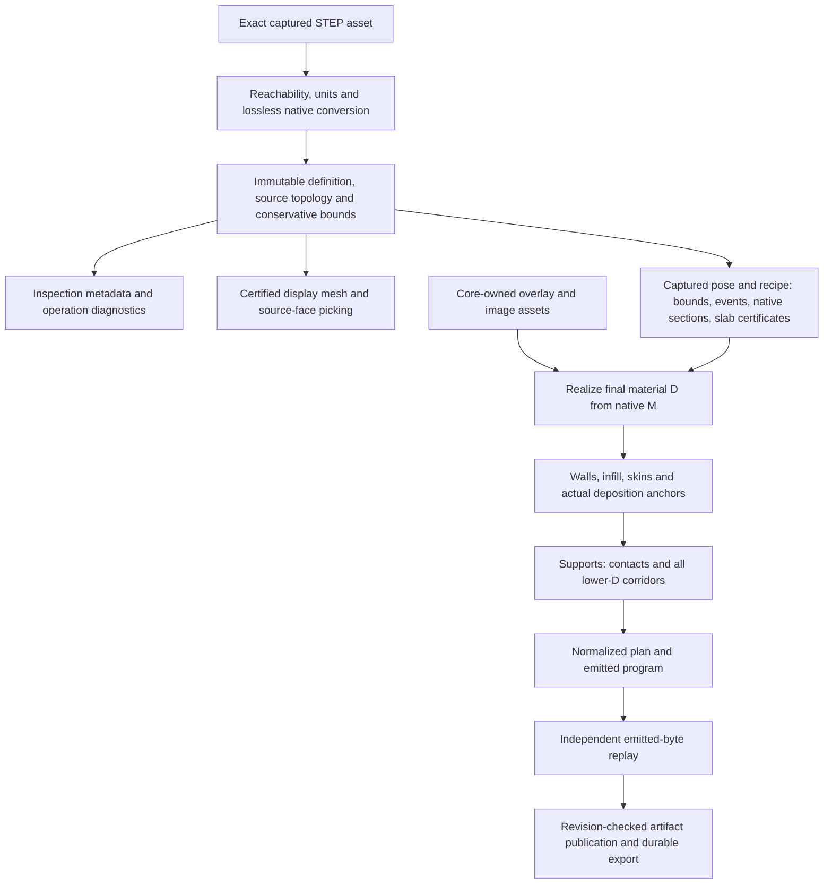

<!--
SPDX-FileCopyrightText: 2026 Spiling contributors
SPDX-License-Identifier: OSL-3.0
Licensed under the Open Software License version 3.0
-->

# Native geometry parity: trimmed BREP through manufacturing

Status: proposed. This RFC specifies a target architecture and acceptance gates, not implemented support. Current executable contracts and recorded evidence remain authoritative until an explicit cutover. No new kernel, mesh-based slicing fallback or physical printer qualification is proposed.

## 1. Decision and user outcome

Make Spiling consume the practical geometry families of its pinned Monstertruck kernel through one native pipeline: source import, faithful inspection/picking, native sections, planar manufacturing, emitted program and independent replay. A rounded housing, tapered fitting or spline-trimmed bracket should not fail solely because its exporter chose a different exact surface representation.

The target is **operation parity on bounded, valid trimmed geometry**, not an enum checklist. Representing a sphere does not establish sphere-plane intersections, trim correctness, global bounds or layer fidelity. Coverage is recorded per operation and numerical envelope. A difficult but valid instance can exceed resource/conditioning limits; it must receive a specific diagnostic rather than a successful approximation with missing geometry.

Decisions:

1. Keep one geometry crate/facade. Monstertruck owns native geometry; Spiling owns admission policy, provenance, query contracts, approximation certification and consumer-facing diagnostics. Changes to general STEP conversion, native intersections or topology belong in the public kernel fork, not a second implementation in the planner.
2. Replace the plane/cylinder-only source model with generic trimmed-face records and optional analytic descriptions. Classification is descriptive; it is never permission to slice, texture or reuse a slab.
3. Implement one bounded parametric/interval substrate inside geometry, with analytic specializations for exact or tighter results. Native sections remain authoritative. Auxiliary boxes, patch tessellations and search meshes never become the slicing representation.
4. Distinguish source conversion, display, native section queries, slab fidelity, manufacturing and surface-finish eligibility. One unsupported operation must not masquerade as an invalid STEP file.
5. Preserve immutable source identity, source/native topology correspondence, occurrence transforms, final-realized-material support dependencies and independent emitted-byte replay.
6. Do not make AP242, assemblies or arbitrary freeform texturing prerequisites for primitive parity. Specify their interfaces now; ship them as separately accepted extensions through the same pipeline.

Non-goals: a general CAD editor/healer; arbitrary nonmanifold mesh repair; alternate kernels; continuous multi-axis deposition; a new printer backend; color mixing; physically certified output. Broader source geometry does not imply those capabilities.

## 2. Grounded baseline and gaps

Design baseline: all five workspace Monstertruck declarations in [Cargo.toml](../../Cargo.toml) pin `5a4ddb7582c3d7f75a39e800a9fef345cdfe435e`. Earlier entries in the [geometry evidence](../quality/geometry-evidence.md) describe their own measured revisions, not automatic acceptance of this RFC.

| Family | Pinned kernel path, from source inspection | Current Spiling restriction | Work required here |
| --- | --- | --- | --- |
| Plane and circular cylinder | Native plane / posed line revolution, STEP conversion | Admitted with bounded line/circle trim profile | Migrate without regression; keep exact fast paths |
| Cone | STEP cone becomes posed line revolution | Rejected carrier/entity | Cone metadata, apex handling, bounds, intersection and approximation coverage |
| Sphere | Analytic posed sphere and STEP conversion | Rejected carrier/entity | Pole charts, closed seams, critical heights, sections and display certification |
| Ring/horn torus | Analytic torus and STEP conversion | Rejected carrier/entity | Periodic charts, inner/outer rings, critical sets and singular horn qualification |
| B-spline, Bezier and NURBS | Native polynomial/rational surfaces and STEP variants | Rejected, even for geometrically planar surfaces | Knot-span bounds, denominator conditioning, arbitrary trims and native intersection coverage |
| Linear extrusion / general revolution | STEP paths exist; modeling conversion may lower to homogeneous surfaces | Explicit STEP entities rejected | Profile conversion, composed parameterization and the same generic query path |
| Ellipse / spline trims | Kernel conversion exists, commonly to rational curves | Witness store only supports line/circle | Oriented parameter intervals, pcurves, trim topology and conservative curve approximation |
| Hyperbola / parabola / polyline curves | STEP geometry exists, but 3D modeling bridge has conversion gaps | Not admitted | Bounded exact conversion in kernel before facade acceptance |
| T-spline | Modeling enum exists; STEP route / extraction bridge absent | Not admitted | Separate kernel extraction/import project; not a pretend STEP capability |
| Offset / replica / trimmed-surface wrappers | Some useful STEP wrapper routes absent | Not admitted | Reachable-entity conversion and topology/provenance support before acceptance |

“Cone” and “cylinder” need not be separate kernel surface variants. Preserve exact geometry regardless of internal lowering. Conversely, a NURBS label does not imply a difficult freeform shape: representation-equivalent planar/cylindrical sources must use the generic path without requiring approximate analytic recognition.

Known upstream exceptions include spindle/lemon tori and some degenerate toroidal cases. Horn-torus representation is not a claim that its singularity satisfies manufacturing topology. Unimplemented builder branches are not admitted operations. Track these individually; never advertise universal support from kernel enum membership.

Current integration seams:

- [Geometry facade](../../crates/geometry/src/lib.rs): `import_step_with_face_limit`, `projected_extent`, `prepare_section_source`, `section_with_byte_limit`, `tessellate_with_budget`.
- [Private native definition](../../crates/geometry/src/kernel/mod.rs): `Definition`, positional `FaceBoundaryRefs`, `BoundaryCoedgeRef`, line/circle `BoundaryCurveMm`.
- [Importer](../../crates/geometry/src/import/mod.rs): carrier parsing, source/native identity checks and single-shell admission; [reachable AST gates](../../crates/geometry/src/import/ast.rs) and [units/schema](../../crates/geometry/src/import/units.rs).
- [Contracts](../../crates/contracts/src/geometry/mod.rs): `FaceInfo.carrier: FaceCarrier` is exhaustively plane/cylinder; definition identity incorporates `step-planar-cylindrical-v1`.
- [Sectioning](../../crates/geometry/src/section/mod.rs): analytic crossing gate, native prepared Boolean with clipping solid, planar-cap extraction, native-curve sampling.
- [Tessellation](../../crates/geometry/src/tessellation/mod.rs): native mesh production with plane/cylinder whole-triangle checks, then separate f32 packing checks.
- [Manufacturing protocol](../protocol/manufacturing.md): actual-height scheduling, native M versus realized D, offsets, deposited-anchor support and captured provenance.

Pinned kernel references: [surface representations](https://github.com/pquerna/monstertruck/blob/5a4ddb7582c3d7f75a39e800a9fef345cdfe435e/monstertruck-modeling/src/geometry/surface.rs), [STEP-to-modeling conversion](https://github.com/pquerna/monstertruck/blob/5a4ddb7582c3d7f75a39e800a9fef345cdfe435e/monstertruck-io/src/step/load/step_geometry/geom_impls/to_modeling.rs), [native bounds](https://github.com/pquerna/monstertruck/blob/5a4ddb7582c3d7f75a39e800a9fef345cdfe435e/monstertruck-modeling/src/bounding/mod.rs), [curve subdivision](https://github.com/pquerna/monstertruck/blob/5a4ddb7582c3d7f75a39e800a9fef345cdfe435e/monstertruck-traits/src/algo/curve/mod.rs) and [native plane-cut composition](https://github.com/pquerna/monstertruck/blob/5a4ddb7582c3d7f75a39e800a9fef345cdfe435e/monstertruck-solid/src/transversal/integrate/mod.rs).

Reuse available kernel ingredients rather than rebuilding them: bounded patch evaluation/derivatives, positive-weight structural bounds, strict mesh refusal, periodic meshing and prepared Boolean budgets. Their limits matter: the current generic curve divider uses sampled interior deviation, native bounds may be loose and need a roundoff audit, and public plane-cut helpers lack the full prepared/cancellation/provenance contract of Spiling's current section adapter. None is automatically an all-domain certificate.

The prior CLI investigation imported/sectioned the box and explicitly refused the rational B-spline fixture at the importer profile gate. That is evidence of current admission behavior, not a general NURBS numerical test. This RFC itself introduces no new runtime evidence.

## 3. Ownership and module boundaries

No new crate is justified by primitive families. Introduce private modules only for distinct invariants, not one module or trait implementation per STEP entity.

| Owner | Target responsibility | Must not own |
| --- | --- | --- |
| `contracts::geometry` | Checked IDs/frames, bounded geometry descriptions, operation reports, policy/error DTOs | Kernel enums, control nets, intersection implementations |
| `geometry::import` | Reachability, units, topology/provenance binding, lossless conversion report | Filesystem paths, project transactions, print eligibility |
| `geometry::kernel` | Immutable native objects, trim/edge-use correspondence, kernel adaptation | RPC/session identity or printer policy |
| Private `geometry::parametric` | Patch/curve domains, chart transitions, interval evaluation, span subdivision, conservative derivative bounds | Planner roles, storage, alternate solids |
| Private `geometry::analysis` | Tight directional support bounds, section events, slab fidelity and invariance certificates | Layer recipe selection or manufacturing mutation |
| `geometry::section` | Native intersections/Boolean adapter, trim classification, oriented closed loops, source witnesses | Polygonized-display slicing or source-face remapping guesses |
| `geometry::tessellation` | Trim-aware display approximation/certification and packed mesh preparation | Manufacturing accuracy authority |
| `core` | Original immutable assets, authoring/undo, durable source/face references | Native caches or numerical capability truth |
| `manufacturing` | Recipe scheduling, process admission, M/C/D realization, ordinary walls/fill/skin/support; narrow existing finish-certificate dispatch | General source-surface dispatch or kernel object ownership |
| `engine` | Capture/composition, worker limits, artifact/RPC publication, revision checks | Independent source parsing or planning |
| CLI / workbench / viewport | Intent/diagnostics, source-face picking, explicit Apply/Compile/export | Geometry classification heuristics, local slicing or repair |

The parametric substrate is private and concrete. Use ordinary functions and existing kernel interfaces; do not export a `SurfacePlugin`, build a second trait hierarchy or serialize native control nets to clients. A stable facade method should correspond to a real consumer query.

## 4. Source model, identity and capabilities

### 4.1 Three identities, three purposes

- **Persistent source identity:** immutable source hash, selected source root/body when that feature is introduced, canonical source face use. This is what saved overlays target.
- **Session query identity:** rebuilt definition/face/chart/span handles tied to the current kernel/import producer and scene publication. These never persist as painting coordinates or project references.
- **Derived identity:** captured source + occurrence pose + query policy + algorithm/kernel revisions; M identity additionally binds section/slab, and D identity additionally binds applied overlay content/mapping.

Never use an approximately recognized primitive, native allocation address, sampled polygon ordinal or display triangle ordinal as persistent source identity. Internal edge splitting may map several native segments to one source edge use; it must preserve parameter ranges and orientation. Existing canonical source face uses must remain one-to-one unless a separately designed face-remap operation is adopted. Refuse unreported source face loss/merging.

### 4.2 Face inspection description

Replace `FaceInfo.carrier` with a checked `geometry` description. Proposed public shape, not an executable declaration:

```rust
struct FaceGeometryInfo {
    family: SurfaceFamily,
    analytic: Option<AnalyticSurfaceDescription>,
    domain: FaceDomainSummary,
}
// SurfaceFamily: plane, cylinder, cone, sphere, torus,
// bspline, nurbs, linear_extrusion, revolution, tspline.
// Family describes admitted native geometry, not STEP text alone.
```

Keep `face_id`, `surface_face_entity`, `source_entity_kind`, orientation and original source provenance. Record source surface entity kind separately from face-use entity kind, so source encoding and modeled family are not conflated.

`AnalyticSurfaceDescription` has validated, definition-local mm parameters for plane, cylinder, cone, sphere and torus. Use complete right-handed frames where phase/chart inspection needs them, finite positive radii, explicit cone parameter convention and signed axis/orientation semantics. Normalize all angles from declared units before kernel construction; do not inherit angle-magnitude heuristics. Analytic recognition of a NURBS surface is optional optimization and cannot change its source identity or bypass generic proofs.

| Analytic description | Parameter contract |
| --- | --- |
| Plane | Source-local origin, orthonormal tangent frame and normal; face-use orientation is separate |
| Cylinder | Axis origin/right-handed frame, positive radius; bounded axial/angle domains come from trims, not an invented fixed height |
| Cone | Axis frame, reference-plane radius and explicit signed semi-angle in radians; trim domain determines the physical branch/apex; reject inconsistent or singular parameter conventions rather than taking absolute values |
| Sphere | Center, positive radius and chart frame; pole-normal availability is explicit |
| Torus | Axis frame, positive major/minor radii, explicit regular-ring versus singular/other classification; no silent radius swapping |

`FaceInfo.orientation` means material-side orientation relative to the regular carrier frame, not merely an unprocessed STEP boolean. At a singular point, an oriented limiting fan/neighboring chart replaces an undefined point normal. Spline/sweep descriptions expose bounded degree/span/profile summaries only where useful for inspection, not their control data.

`FaceDomainSummary` reports bounded trim loop counts and chart periodicity/singular-boundary presence. It is descriptive, not a full UV polygon or guarantee of invertibility. Large topology tables are paged or stay native. A public inspection response contains no control net, arbitrary expression or per-point evaluation RPC.

### 4.3 Operation-specific evidence

Do not add a single `supports_slicing` boolean. An imported definition proves valid native conversion and conservative bounds. An inspected family does not prove a particular section, slab, pose or recipe.

A bounded `GeometryOperationReport` identifies operation, producer/kernel revision, captured definition/pose/policy, evidence state and diagnostic references. States are:

- `not_evaluated`: no numerical attempt for this exact query;
- `certified`: the named query passed its specified invariants;
- `unsupported`: an implemented/profile capability is absent;
- `indeterminate`: bounded analysis could not decide a numerical/topological obligation;
- `failed`: invalid geometry or native operation failure.

Cancellation and resource exhaustion are terminal operation errors, not successful `indeterminate` results. Reports may explain them, but must not authorize downstream geometry. Preflight must preserve not-evaluated/indeterminate versus passed. Avoid a per-face × per-layer capability matrix: aggregate by operation with bounded representative witnesses, counts and explicit truncation.

Import and display are separate operations. Engine staging may commit an imported bounded definition without a mesh if display certification is unavailable; expose an explicit non-rendered body/diagnostic and disable face picking for it. Do not publish uncertified triangles. A fully unsupported conversion remains an import failure. This deliberate change requires an explicit geometry-only scene state; clients must not infer that zero mesh bytes means an empty project.

Geometry-only scene publication is separately gated, not a shortcut for G1 end-to-end acceptance. It needs per-definition mesh availability, a source-face table independent of mesh artifacts, meaningful scene-fit bounds, atomic mixed rendered/non-rendered scenes and coherent undo/save/reopen/native-pin accounting. Until that cutover is complete, engine import/open retains its existing atomic import-plus-display policy; the geometry facade still keeps these operations separate. A family cannot count as complete inspection parity while its expected display/picking path is missing.

### 4.4 Private source/native parameter correspondence

Retain a compact `SourceParameterMap` beside each native curve/coedge/chart association: original source interval, native interval, orientation, periodic branch, unit conversion and exact conversion/subdivision map. Borrow shared native geometry instead of duplicating a BREP. Maps compose pose/inversion, affine reparameterization, conic-angle-to-rational maps and validated span restrictions; do not store an arbitrary expression language.

A rational revolution coordinate is not generally the original angle in radians. Source and converted UV values are not interchangeable even when the geometry is exact. Validate map coverage, orientation, endpoints and singular strata over complete intervals. If conversion cannot provide the correspondence a query needs, that operation refuses explicitly; it must not invent a map from sampled nearest points. An import claiming lossless conversion still needs the source-to-native geometric/topological equivalence required by its admission contract.

Generic native `ParameterCurve<C,S>` means `S(C(t))` in the decoded surface's internal UV chart. Raw STEP pcurves require checked construction that retains their raw-to-internal chart; native-pair construction has a genuine identity input chart. Decomposition must preserve that distinction, and native conversion/export must apply the captured map exactly once. A shared formatter receives an explicit chart; it never guesses the curve's coordinate convention from the surface enum.

Numeric STEP trim selectors are directed source endpoints, not an ascending storage range plus an inversion flag. `sense_agreement` also selects which arc is retained on a periodic basis. Retain the original selectors, distinguish a genuinely unbounded/periodic basis from an explicitly bounded inner trim, and prove the chosen active branch. Nested trims and pcurves on swept surfaces use the same explicit source/native/export chart maps; a writer cannot change the profile's parameter gauge while leaving outer selectors or surface UV coordinates unchanged. Include periodic-lift and coefficient roundoff in the correspondence, not an unqualified identity claim.

Exported face `same_sense` composes the native face use with the UV map's determinant sign; exported edge sense likewise follows the scalar parameter map. STEP `VECTOR` magnitudes multiply normalized direction ratios, as in [OCCT's independent conversion](https://github.com/Open-Cascade-SAS/OCCT/blob/V7_9_0/src/StepToGeom/StepToGeom.cxx#L2465-L2493). Likewise, a 2D placement reference direction defines orientation, not radius scaling; normalize its ratios through checked dimensional/finite/nonzero admission. This format-defined normalization is distinct from application poses and native processor matrices: their actual accepted affine polynomial must not be silently normalized.

Writer/reader agreement alone is insufficient interoperability evidence. Independently cross-check directed trim behavior against [OCCT's STEP conversion](https://github.com/Open-Cascade-SAS/OCCT/blob/V7_9_0/src/StepToGeom/StepToGeom.cxx#L2247-L2395) and [periodic trim selection](https://github.com/Open-Cascade-SAS/OCCT/blob/V7_9_0/src/Geom/Geom_TrimmedCurve.cxx#L91-L141), with independent physical positions, derivatives and normals. Representation-changing rationalization or fitted surface export requires its own non-affine map/error proof; otherwise refuse it rather than advertising an affine chart correspondence.

Finite tensor support is part of the original carrier contract, not merely a
hint for finding a UV proposal. An affine/conic correspondence must retain its
coefficient-derived UV curve and prove both nominal support and the complete
inverse uncertainty tube within the original knot domain. Inward rounding,
clamping or replacing the curve cannot repair a source boundary outside that
domain. Diagnostic authoring may instead construct a sufficient finite carrier
on the same exact physical plane from certified bounds of every complete
original boundary interval, preserving all original spatial curves, parameter
phases, topology and material orientation. That is a correction to an authored
representation, not an import fallback or retroactive qualification of an
invalid fixture.

## 5. Geometry facade API changes

Names below specify responsibility and data semantics. They are proposed Rust-level interfaces, not compatibility shims or a request to expose each method over gRPC.

```rust
fn import_step(
    bytes: &[u8], limits: ImportLimits, cancel: &AtomicBool,
) -> Result<Definition, GeometryError>;

fn projected_bounds(
    definition: &Definition, direction: UnitDirection,
    policy: BoundsPolicy, work: &mut GeometryWorkBudget,
    cancel: &AtomicBool,
) -> Result<ProjectedBounds, GeometryError>;

fn analyze_height_domain(
    definition: &Definition, frame: HeightFrame,
    range: HeightIntervalMm, policy: AnalysisPolicy,
    limits: AnalysisLimits, work: &mut GeometryWorkBudget,
    cancel: &AtomicBool,
) -> Result<HeightAnalysis, GeometryError>;

fn prepare_sections<'a>(
    definition: &'a Definition, policy: SectionPolicy,
    limits: PreparationLimits, work: &mut GeometryWorkBudget,
    cancel: &AtomicBool,
) -> Result<PreparedSections<'a>, GeometryError>;

impl PreparedSections<'_> {
    fn section(&self, plane: PlaneMm, limits: SectionLimits,
        work: &mut GeometryWorkBudget, cancel: &AtomicBool)
        -> Result<SectionOutcome, GeometryError>;
    fn analyze_slab(&self, request: SlabRequest, limits: AnalysisLimits,
        work: &mut GeometryWorkBudget, cancel: &AtomicBool)
        -> Result<SlabAnalysis, GeometryError>;
}

fn tessellate(
    definition: &Definition, policy: DisplayPolicy, limits: MeshBudget,
    work: &mut GeometryWorkBudget, cancel: &AtomicBool,
) -> Result<CertifiedMeshArtifact, GeometryError>;
```

`Definition` remains immutable and kernel-opaque. Retain the existing specialized vertical-wall/cylinder certificate queries as narrow operations; generic geometry does not make every face eligible for them. Replace old facade entry points/callers in one cutover, not parallel old/new interfaces.

Important result contracts:

- `ProjectedBounds` encloses the true min and max separately: `minimum: [lower, upper]`, `maximum: [lower, upper]`. The overall safe interval is `[minimum.lower, maximum.upper]`. Include achieved uncertainty, method and witness references. A loose AABB projection is sufficient for broad-phase exclusion, not contact placement. `BoundsPolicy` requests maximum endpoint uncertainty; unmet tightness returns an explicit error/report rather than a misleading exact pair.
- `SectionPolicy` names native residual, curve chord/plane residual budgets and topology requirements. It cannot silently increase frozen maxima. Search-mesh tolerance is separately named and never added as though it were source accuracy.
- `SectionOutcome` distinguishes `Empty`, area-bearing `Regions`, and proved `CriticalContact` (point/curve/coincident face). An unresolved boundary event returns a typed error/report, never a successful contact or empty result. Region loops have a certificate and optional bounded source-span attribution. A manufactured layer requires certified area regions, not a contact promoted into a polygon.
- `HeightAnalysis` isolates events independently of expensive prepared Boolean seeds. It reports covered height ranges, event brackets/critical strata and opaque evidence for completeness. Preflight can request bounded height analysis without pretending a section has been executed.
- `SlabRequest` binds definition-local build direction/pose, a finite build-height interval, interior sample height, native shape-error policy and event policy. `SlabAnalysis` returns certified regular/event partitions, sampled native regions or their captured identities, boundary-motion/shape-error bounds, topology status, optional invariant-domain certificate and conservative occupied/covered slab envelopes. Unknown is not invariant.
- `CertifiedMeshArtifact` includes existing packed chunks plus producer-side carrier/trim/coverage evidence; f32 quantization remains separate.

In-process certificates have private constructors and bind the actual immutable native capture and policy. Wire reports describe evidence; deserializing a report is not permission to manufacture. Persist bounded policy/provenance/coverage summaries and representative witnesses in bundles, not complete interval trees or every patch's proof payload.

`GeometryWorkBudget` is a concrete cumulative query counter, not a new scheduler. Charge subdivision nodes, interval root iterations, native work and source-span attribution before growth; do not reset on each recursive call, retry or cache miss. Per-result/preparation limits bound owned capacities. The engine/manufacturing job retains aggregate memory authority: simultaneous original/staged results, prepared caches and scratch must fit its existing accounting. Returning an owned allocation transfers its accounting, not permission to forget it when a query context ends.

Section source admission includes native seed/cache capacities and each distinct definition's pinned query proof once, within 60 MiB. The common source/query/output allowance is 64 MiB, leaving 4 MiB query-seed headroom; the packed section cap remains independently 16 MiB. A direct section byte limit narrows packed output, not native source preparation. A prepared section query receives remaining shared capacity after all retained sources/proofs and coexisting caller outputs. Packing charges pending f64 points and encoded copies while both are live. Native Boolean intermediate limits admit each object separately; borrowed BREP, opaque native temporaries and allocator overhead are not a hard aggregate or RSS guarantee and still require external host-memory limits.

Native section preparation explicitly separates candidate seed resolution (`SECTION_SAMPLING_TOLERANCE_MM`, 0.005 mm) from unchanged Boolean geometric tolerance (`SECTION_BOOLEAN_TOLERANCE_MM`, 0.00001 mm). Source, clip and intermediate seed tessellations are search data only, never display or completeness certificates. Every successful crossing section, direct or cached, must enclose its actual native intersection curves and discharge whole-source-face plane-root coverage. A missing hole or disconnected candidate must therefore refuse rather than certify a partial section. Prepared slab queries receive the same remaining shared allowance; each local slab scratch object retains its independent 32 MiB cap, while standalone height-query total admission remains 32 MiB including pinned proofs.

### 5.1 Immutable source preparation and exact-plane root reuse

`PreparedSectionSource` owns bounded search seeds and immutable original-face
trim/original-boundary preparation while borrowing one immutable definition.
Count all owned preparation and pinned definition proofs once in the source
pool. A one-off section uses the same preparation rules, not a second geometry
implementation.

`PreparedMaterialSource` is the explicit manufacturing owner: one raw section
preparation plus a bounded immutable inventory of selected source vertex
transport plans for that same definition instance. Prepare this owner once per
distinct definition before publishing its retained-byte count. Occurrences and
adaptive retries borrow those plans rather than selecting `G`, its frame,
fraction, exits or physical correspondence again. Raw section APIs remain on
`PreparedSectionSource`; they do not acquire material-admission prerequisites.

Retained plan lookup checks exact definition and Native vertex ownership and
cancellation. It reuses source-only geometry selection, **not** source geometry
qualification or any closed-slab, radial, flow, metric, candidate or posed
authority. Keep those proofs fresh, including the existing inactive-support
exclusion before qualification. Standalone material queries use the identical
algorithms with local plan ownership, not another realization convention.

Count selected-plan records and owned capacities once in the existing source
pool, before capture. Pinned plan storage is not deducted a second time from
query scratch; locally owned plans still reserve their simultaneous storage.
No lazy retained growth, cached error or counter reset is allowed. Drop material
preparation at the existing compilation source-lifetime boundary.

Within one section query, an opaque native `PreparedFacePlaneRoots` retains
the complete ordered original-3D and source-chart trim-root inventories.
`ValidatedPlaneTrimBoundaryBinding` supplies the original oriented coedge,
retained original curve, active range, unit map and physical chart error.
`prepared_face_plane_roots` constructs the inventory; `root_chart_for_cut`
selects an original cut's numerical UV anchor; `validated_face_plane_coverage`
can consume that same inventory instead of isolating it again.
`ValidatedPlaneCoverageQuery` groups borrowed plane, candidate, endpoint-binding
and optional inventory inputs without allocation; numerical policy and resource
budgets remain separate. Candidate end association, continuation/extension,
complete interior coverage and endpoint sealing still run under the actual
coverage policy.

Reuse binds exact native plane coefficients, immutable face/carrier and
orientation, complete chart/coedge association, original curve binding/range,
units and chart error. Validate identity at consumption; a foreign or changed
input is an error, not a cache hit. Numerical anchor coordinates, an equal
edge ID or a nearby plane are insufficient. Missing original incidence still
requires complete no-crossing proof. No inventory is itself a source-M or
slab certificate.

Keep original owners and borrowed query inventories in separate stable storage,
not self-referential Rust objects. Drop inventories after that query's endpoint
receipts are sealed; do not persist them or reuse them across planes. Charge
preparation, identity checks, lookups and failed attempts cumulatively. Source,
inventory, candidate and output capacities coexist under the shared allowance.
Native winding scratch receives the current query allowance even when its
original trim domain was prepared earlier with more free capacity.

Within that same immutable exact-plane owner, identical endpoint chart requests
may share a bounded proposal table keyed by the complete directed original
face/coedge identity and exact source-cut parameter bits. A table hit reuses
only the already qualified root-chart enclosure; actual candidate association,
endpoint sealing, uniqueness and complete original-face coverage remain fresh.
Include table capacities in coexisting query admission, charge lookup work and
propagate errors. No request is rounded or shared across gauges or planes.

An exactly known endpoint coordinate has zero physical span; it is not an
unresolved positive-width extension. Prove its unique original-carrier point
with a constant-plane constraint in the original uniqueness tube, retaining
complete trim incidence and material orientation. Do not widen the guide,
invent an extension arc or relax the endpoint budget to make a point
nondegenerate. Refinement may reuse an identical already-certified domain
instead of repeating the same deterministic inclusion solve.

### 5.2 Affine-plane reduction inside native continuation

Repeated section queries must be affordable under the unchanged whole-job work
and deadline limits, not only individually certifiable. A generated face/plane
curve currently solves four native UV unknowns, although one original carrier
is an affine plane. Eliminate that plane's two dependent UV coordinates inside
Native; do not introduce a second Root section implementation or an analytic
replacement for the source geometry.

For source carrier `S(u,v)`, actual native plane `P(a,b)=p+A*a+B*b`,
and the existing guide-coordinate plane `g(t)·x=d(t)`, the reduced equations are
`cross(A,B)·(S(u,v)-p)=0` and `g(t)·S(u,v)-d(t)=0`. The second equation uses the
unchanged native guide/projection jet and raw parameter. It is equivalent to
the four-variable system's averaged-point equation on an actual common root;
no native parameter gauge is replaced by arc length, angle or sampled leaders.

For an original Native leader `L(t)`, retain its position and derivative jet
inside the private coordinate authority. Evaluate `F=L'·(P-L)`,
`partial_t F=L''·(P-L)-L'·L'` and
`partial_tt F=L'''·(P-L)-3*L'·L''` with the shared displacement formed first.
These are the same native coordinate law, not a recentered geometry or new
parameter. Separately enclosing world-position dot products loses their
common-origin dependency. Generic and reduced implicit jets must consume the
same correlated partials; varying explicit endpoint planes retain their own
combined-coefficient interpolation law.

A distinct private proof authority must certify whole-span two-dimensional
existence, uniqueness and transversality, then reconstruct the actual plane UV
enclosure through a nonsingular native affine chart. Reconstructed four-UV
roots must retain the original binding, admitted domains and endpoint/trim
association. Position, first and second derivatives come from the same reduced
implicit system with outward arithmetic; evaluating a smaller span cannot
certify derivatives on the requested whole span. Original source/plane
residuals, continuation, full-face completeness, endpoint sealing and material
proofs remain mandatory. Existing constructive extrusion authority remains
separate.

This is an internal specialization of the existing prepared-curve API for
every supported source family against a qualified affine plane. Keep the
generic two-carrier system for genuinely non-affine carrier pairs. Qualify
actual plane coefficients, injective chart and original guide equation, not
family labels or nearby plane fits. Unsupported exact reduction must not
invent success or lose previously supported branches.

Use fixed-size stack proof data; admit retained metadata/scratch, charge actual
construction, contraction, derivatives, reconstruction and failed attempts,
and propagate cancellation under existing limits. Fewer computations and
tighter proof domains may reduce charged work; changing counter weights,
budgets, tolerances or deadlines is not an optimization. Adoption requires
independent jet/root oracles, reversed/posed gauges, invalid-transversality and
resource/cancellation properties, followed by the unchanged full fitting and
housing operator workflows. This planned specialization is not qualification
of those workflows.

### 5.3 Translation-stable native coefficient evaluation

Native curve and tensor-surface Taylor enclosures must not manufacture derivative
uncertainty from a large constant source origin. Where the existing native
basis admission proves partition unity, evaluate the identical polynomial as
`p0 + sum(Bi * (pi - p0))`, with `p0` an original active control coefficient.
Use outward interval subtraction, not rounded replacement control points.
Outside the proved partition retain the uncentered sum.

Apply the same identity to ordinary and homogeneous coefficients. Original
coefficient hulls, rational ratios, denominator separation, knot/continuity
policy and all native ranges remain authoritative; a tighter enclosure cannot
cancel an unproved pole or lower a representation. The shared accumulator owns
this arithmetic for both curves and surfaces, including the original Native
guide. Retain one charged visit per original active control, bounded stack
data, cancellation and existing work/resource limits. Adoption requires posed
whole-span independent jets, rational-pole and knot-policy properties, then
the real operator workflows; changing budgets is not a substitute.

### 5.4 Retained-bound-first sampling and certified Green quadrature

Geometry may borrow the already certified whole-piece native jets as coarse
enclosures on a contained query. Preserve the original binding, active range,
units, parameter gauge and native C1 qualification; a piecewise Hessian alone
does not establish smoothness. Charge bounded piece lookup/aggregation, retain
no coordinate cache, and refine through the existing native jet API only when
the coarse certificate cannot discharge the requested chord/plane obligation.
Do not repeatedly reconstruct an implicit branch merely to rediscover a valid
bound already retained by that same branch.

For a C1 arc with bounded piecewise second derivative norm `M`, raw parameter
width `h` and true endpoint-chord length bound `L`, its projected Green integral
lies in the true endpoint-chord integral plus/minus
`M*h^2*L/8 + M^2*h^4/32`. This follows from the zero-endpoint interpolation
remainder and integration by parts, not from treating sampled polygon area as
native truth. Project original endpoint error enclosures outwardly before the
chord integral. The same whole-query curvature certificate owns both sampling
and this analytic remainder. Non-C1 queries retain their existing independent
image/integral path; no zero-curvature or sampled-area fallback is admitted.

A private smooth-range receipt may carry a positive native C1 qualification
down the sampler's DFS, bound to the same immutable prepared binding, unit
view, active restriction and containing closed parameter interval. Validate
identity/containment and charge cancellation/lookup work before skipping only
the repeated native smoothness proof. Every child still evaluates its own
curvature/position/plane bounds and retains original knots, coordinate
transitions, endpoints and Green obligations. An unqualified parent provides
no negative authority; children may independently qualify. Include live
receipts in the existing fixed-stack admission, not a new cache allowance.

### 5.5 Scalar native obligations before unused spatial evaluation

Trim-plane inventory needs the native scalar `n dot (S(U(t))-origin)`, not every
spatial surface derivative. Pull that exact functional through native carrier,
affine and rational coefficient evaluation before interval basis expansion,
then compose with the original UV curve jet. Retain interval plane coefficients,
world units, original chart/3D gauges, denominator and knot policies, complete
root isolation, correspondence and endpoint/whole-face coverage. Unsupported
scalar specialization may use the existing full certified evaluator, never a
sample or fitted carrier. An original plane coefficient identity that makes
the entire scalar constant can discharge that query before unused implicit
spatial jets, after the same range, binding and cancellation admission.

These changes retain existing work, storage, chord, plane, area and deadline
limits. Qualification remains complete real-part compilation and independent
replay, not a faster isolated query or a widened allowance.

### 5.6 Borrow immutable original trim proofs across prepared queries

`PreparedSectionSource` already owns the admitted original face-trim domains.
Prepared section, directional-support, slab, endpoint and collar analyses must
borrow those same domains through one geometry-owned source context rather than
reconstruct their coefficient correspondence for every layer. Bind every lookup
to the exact immutable definition and original face identity. Standalone queries
use the same algorithms with a query-owned domain; do not introduce another
planner, cloned domain cache or unsafe self-reference.
Nested graph and radial-link proofs must forward that prepared source context;
replacing it with a standalone context discards the job's admitted originals.

Source retention is admitted once. A borrowed domain consumes no second retained
allocation, but its current classification must use the current query's bounded
scratch allowance. Where Native's limit includes domain metadata, add only that
already-admitted metadata with checked arithmetic. Cancellation and lookup work
remain charged. Query-dependent classifications, roots, heights, events, contact
and material/slab certificates remain fresh; borrowing source authority does not
authorize borrowing a different query's result.

Native `with_surface` and `with_curve` callbacks hold their owner's
non-reentrant mutex. Finish the callback before calling another helper that
acquires that same owner; borrowed source authority does not make nested
locking safe.

### 5.7 Reject disjoint candidate meshes before dense pair admission

Native Boolean loop construction may cache finite coordinate bounds of its exact
immutable polygon seed faces for that query. Strict separation on any coordinate
axis proves that every seed-triangle pair would fail the existing mesh
extractor's AABB test; omit that interference/reconstruction call before admitting
its Cartesian triangle product. Touching, overlapping, empty, missing or
nonfinite bounds cannot prove separation and retain the existing pair pipeline.

Charge the source-position scan, pair checks and failed admissions; bound combined
requested and actual cache capacity under the existing query scratch policy.
Remeshing creates a new query-local cache. Every admitted pair keeps its original
Cartesian work/triangle limits, native reconstruction and two-sided genealogy.
This is candidate broadphase only: no mesh box establishes original native-face
emptiness, completeness, material or topology. Root's independent original-root
and whole-face coverage remain mandatory.

### 5.8 Separate geometric regularity from a certified pole chart

A collapsed covering coordinate does not by itself make the original surface
singular. Critical material analysis may use a nonvanishing geometric normal
derived from original carrier coefficients when its geometric regularity,
orientation and convexity are proved independently of that coordinate rank.
For a nonsingular affine image of an original analytic sphere, use the actual
affine cofactor/inverse coefficients and source position enclosure; the positive
definite implicit quadratic supplies the geometric curvature sign. Admit the
actual face/processor/determinant orientation, not an assumed outward normal.

Any polar-domain overrun must be covered in full by an original connector
independently qualified by Native as `SphericalPole`, with the same shared vertex
and complete oriented incoming/outgoing occurrences. An original
`EndpointUncertainty` joint may propose a completion but grants no pole authority.
Certify the entire completion/world tube under the existing source-chart error,
including retained map margins; exactly one original connector must qualify.
A nearby endpoint, longitude bound or rank failure alone is not a certificate.
Require one chart sheet; aliases, interior folds, missing incidence and
singular/projective maps do not acquire this proof.

A meridian ending at a pole cannot obtain a regular longitude inverse by
dividing by its vanishing projected XY radius. A separate meridian-graph
receipt may instead prove a positive whole-range radius in the actual
meridian plane, oriented latitude phase/monotonicity, and distinct transverse,
radial and carrier-frame physical-error bounds. Retain actual affine processor
coefficients and their uncertainty; floating axes are not assumed orthonormal.
Whole original/native position and relative-tangent correspondence remains
mandatory. This is a latitude graph with a world tube, not uniform zero UV
uncertainty or an ordinary inverse receipt.

A closed before-exit comparison may use a stronger scalar support instead of
an ill-resolved two-dimensional inverse. Seal equality of the complete original
affine polar functions, full Native-to-UV maps, literal endpoints/exits and
normalized gauges; polar offsets and the actual middle bulge must be zero.
Then every raw star piece has the same polar function `phi(s)` and its outer
trace the same `phi(1)`. Fresh validated trigonometry must prove the retained
principal branch/hemisphere, `0 < R² = sin²(phi(1)) < 1`, strictly positive
whole-range `d sin²(phi(s))/ds`, and the matching support-row/polar-derivative
orientation. Do not assume a floating representation of pi has zero sine.
The raw squared covering radius is at most `R²`, strictly before `s=1`;
the reference radius is `s² R²`. Convexity of squared norm controls the entire
Cartesian comparison homotopy. Exact common endpoint expressions retain the
closed zero at `s=1`; complete outer-boundary ownership still excludes every
unauthorized zero. This sufficient lane neither changes canonical G nor
widens an inverse proposal; unproved guards retain the original inverse path.

Keep graph authority pending until both actual source-vertex joints receive
Native whole-connection image certificates; every designated polar endpoint
must qualify as `SphericalPole`. Ordinary endpoints retain their own Native
joint obligations. One canonical private chart-certificate kind distinguishes
unproved, inverse/exact and completed graph authority; do not persist a second
certification boolean that can disagree. Explicit declarations are never
replaced, and declared-source inverse shortcuts cannot consume graph authority.

Transport may prefer a whole-coefficient/forward-qualified meridian with an
oriented polar front as a search anchor when no literal constant anchor exists.
The complete ordinary chain still transports its original phase, including
wide sectors; all final joint, winding and bounded-sheet gates remain unchanged.
Search ordering never authorizes a nearest-angle or source-domain shortcut.

Retain all original source cells and their position, height, distance,
radial-degree, stationary coverage, manifold and edge-link obligations. Use the
same source geometric normal for face and coedge incidence. Do not snap UV,
discard pole cells, replace the carrier or infer global material closure from
the implicit equation alone.

A closed co-carrier proof separately needs a strictly feasible original trim
witness for every source face. This is an existence query: a proposed point
must be certified `Inside` against the whole original boundary, not merely
evaluated on the carrier. An unresolved seam/pole corner cannot abort search
before other bounded candidates are considered. If none qualifies, refuse;
an unresolved candidate never becomes a feasible witness or a complete cover.

### 5.9 Bound planar proof pairs and reuse exact oriented geometry

Material clearance must examine every potentially close nonincident segment
pair, not the complete Cartesian inventory twice. A geometry-owned, balanced
boundary-order AABB hierarchy may reject a subtree only when a downward-rounded
axis gap is strictly greater than the unchanged clearance margin. Touching,
uncertain or overlapping boxes retain the existing narrowphase. Enumerate
unordered pairs once; retain edge-degeneracy and adjacency rules. The hierarchy
is only a rejection index, never material or topology authority.

Charge construction, visits, narrowphase pairs and actual vector capacities.
Bound recursion and scratch; reclaim temporary index storage on every exit
without refunding work. Overlapping/pathological inputs still encounter the
existing resource gates; do not promise universally subquadratic work.

A complete exact oriented-cycle bijection may replace tolerance-based
correspondence search. Compare all finite coordinates, orientation and hole
roles, permitting only cyclic rotation and inventory order. Repeated/ambiguous
anchors retain the general proof path. Exact floating-boundary identity proves
zero relative coordinate displacement, not zero native/source approximation.
Keep native tube/pose/chord/plane contributions in achieved bounds and preserve
the original clearance obligation: correspondence displacement for separated
cycles, or the full original projection tube for filled projection. The proved
native clearance then applies to an exactly identical candidate; caller
provenance or a matching hash alone is insufficient.

### 5.10 Contract affine-plane systems from paired source functionals

For source surface `S`, query plane `(n,O)` and unchanged Native leader `L`,
the reduced equations remain `n dot (S-O)` and `L' dot (S-L)`. Evaluate both
source functionals together before unused spatial Taylor coordinates, sharing
the original basis and rational denominator. Interval-centered coefficients
retain `P-L` directly, including homogeneous `P-wL`; do not distribute a large
independent world-origin offset. Generic revolution pulls actual rotation,
processor pose and inversion through original profile coefficients. Unsupported
profiles retain one shared certified spatial evaluation, not a surrogate.

Strict inclusion still covers the entire original parameter span and uniqueness
domain. Full spatial reconstruction, residuals, time partials and first/second
derivatives remain mandatory. Transversality may be established on the
all-root-containing whole-span image; this is not permission to shrink the
parameter query. Mean-value reconstruction outside that image requires jets on
the complete convex connecting domain. Preserve the existing piecewise source
admission policy without inventing whole-C1 or Hessian authority. Failed
attempts and all actual evaluator work retain the existing gates.

If original strict inclusion succeeds but reconstructed plane UV cannot fit
its immutable chart domain, a bounded necessary-root image refinement may
isolate each diagonal of the same centered interval equation. Require a
separated interval denominator and intersect the existing genuine root image;
then rebuild whole spatial, transversality and plane-UV receipts. The original
existence/uniqueness domain never changes. Preserve the original healthy-path
image/proposal arithmetic and charge every additional operation; stronger
admission must not invalidate later original-branch endpoint obligations.

Native's `max_retained_bytes` bounds owned source/proof storage, not evaluator
stack memory. Fixed-capacity tensor/basis workspaces must be included in both
full and reduced formulation cost comparisons using their actual layouts;
these comparisons are not a scratch-byte admission API. Shared capacity
accounting and external process memory limits remain distinct. Do not claim
that a retained-byte limit establishes a hard stack or RSS bound.

### 5.11 Distinguish closed-slab topology from whole-source convexity

A blind pocket outside a closed manufacturing band cannot establish global
convexity, but need not prevent a proof of the actual slab-clipped source.
Exhaustively cover original face/edge cells: certify whole-cell height exclusion
outside the closed band; retain all regularity, positive degree, curvature,
distance, pole and source-link obligations for cells meeting it. Unknown-height
cells remain active. Close both cuts with actual original-source material
halfspace caps, never candidate polygons. Prove the calibrated source witness
strictly between both endpoint planes; cap radial signs and source/cap links
must follow from those coefficient-level halfspace constraints.

Scope this authority to the exact immutable source, frame and closed interval.
Only a separately completed whole-source proof may populate the existing global
convexity authority. Adjacent local proofs cannot be ORed into a cross-height
claim: joint acceptance still needs a proof covering the combined height range
or actual nonempty original interface/coface incidence. Keep existing collar,
material correspondence and interface dependencies mandatory; local exclusion
is not a shortcut past closure or component/void calibration.

### 5.12 Preserve tensor identities before independent interval products

On an original knot span where both active bases have proved partition unity,
evaluate the homogeneous control net as its corner, two first-row/column
differences and mixed control differences. This retains exact additive
separability before multiplying independent basis intervals; it is not analytic
recognition or replacement of a spline. Outside that partition premise, retain
the original basis sum.

The two-axis form can be looser on genuinely mixed nets. Retain the independent
one-origin enclosure in the same original-control pass and intersect Taylor
coefficients over the identical complete source/span before span hulling or
rational division. Empty intersections refuse. Original weight/pole admission,
coefficient hulls and piecewise continuity obligations remain mandatory, even
for zero projected functionals.

Share original bases, controls and products; use bounded fixed-capacity
workspace, charge the additional arithmetic and account its actual layout.
Sharper enclosures do not guarantee monotone numerical root proposals or
preconditioners. Qualify actual implicit-curve consumers as well as independent
surface-jet oracles before changing the published kernel pin.


### 5.13 Reuse immutable source admission, not geometric assumptions

A borrowed original-spline evaluator may admit the unchanged complete knot
structure and active range once for repeated leader-knot queries. It owns no
replacement controls, pointer cache or alternate parameterization. Charged
binary span selection retains both closed incident spans; whole-range queries
need no search. Coefficient/basis arithmetic, rational pole checks and physical
continuity obligations remain independent and mandatory for each actual proof.

A common-end query that already holds a sealed original subpath must evaluate
its outer endpoints through that exact nested receipt, after checking the same
prepared source, raw range, projection and containing original uniqueness
domain. A generic whole-curve point query also consumes adjacent closed pieces
and is a different obligation. Neither contract may guess a shared root from
nearby positions or erase original interval/branch identity.

The same rule applies to immutable prepared-root partitions. A charged binary
slice lookup may omit only pieces proved disjoint from the closed query.
Retain every incident piece at an exact joint, in original order; mapped and
reflected sources keep their existing coordinate-joint and one-sided rules.
This changes traversal cost, not branch, smoothness or endpoint authority.

### 5.14 Certify toleranced source material, not fictitious exact seams

**Material interpretation: accepted; implementation and qualification pending.**
Native M denotes the oriented original BREP with its admitted, bounded
source-chart uncertainty. It is not the literal union of independently evaluated
carrier patches that disagree inside that uncertainty. Stored STEP, BREP,
coefficients, parameter gauges, topology and persistent source identity remain
unchanged. A proof-only boundary realization must remain inside the unchanged
source allowance; it is not a repaired import, an alternate kernel, an exact-G1
claim or permission to join nearby, independently identified geometry.

Position residual and relative-tangent correspondence alone do not establish
physical closure. Neither a shared source ID nor a small dihedral interval
supplies the missing two-sided embedding or endpoint fan. This distinction also
applies to an otherwise strict convex-dihedral proof with nonzero source-map
uncertainty. Do not clamp an unresolved sign or infer equality from CAD intent.

Retain an opaque **original coedge correspondence** through import and immutable
native metadata, instead of discarding the completed forward proof. Bind it to
the actual face/edge/oriented use, complete original and UV parameter ranges,
certified parameter map, original span inventory, source displacement and
derivative bounds, UV uncertainty, and endpoint ownership. Exact coefficient
correspondence and completed pole graphs are distinct constructors; a regular
inverse or bare qualification boolean cannot manufacture either authority.
Resolve operands against the same immutable definition, not cached addresses.

A **paired material-link** request consumes both complete correspondences and
the original incidence inventory. Require exactly two opposed uses of the same
actual native edge. Source IDs determine incidence; spatial bounds only reject
nonincident contacts. The certificate proves local material degree one, not
convexity, C1 continuity or a new source parameterization.

Post-selection source-vertex separation may first enclose the complete
original carrier position over an admitted UV knot cell. A box disjoint from
the allowance-expanded vertex support excludes its trimmed subset without a
winding query. Otherwise retain native trim classification and ordinary
subdivision. Use the existing Cartesian functional-jet position enclosure
rather than computing unused Hessians; continuous-C0 position coverage is
sufficient here, not for normal or graph proofs. Native errors, cancellation
and consumed work remain authoritative. This optimization cannot change the
selected source frame, fraction, bulge, exits or canonical G recipe.
The closed-capture raw-face census likewise checks its existing
allowance-expanded carrier height before trim winding. Entire carriers
outside both closed cuts need no trim query. Retain the full second jet
there: annular meridian and independent convexity obligations consume it.

Select the realization lane from immutable original coefficients and topology,
not the success of a placement/slab query. Prefer a proved **carrier-preserving
source law** when available: a unique common boundary `C*(t)` and vertex
completion on the actual original carriers, inside both admitted source charts
and the original `C(t)`/vertex uncertainty. Bind its complete parameter
correspondence, orientation, endpoint fan and component to those same native
IDs. `C*` is an explicit toleranced realization, never relabeled as an exact
conversion of the stored `C`. Tangent carriers require their actual
coefficient-level uniqueness law; ordinary transverse-intersection rank cannot
be invented. Unchanged carriers establish convexity, height or invariance only
after their complete realized trim/link obligations also pass.

The source-only recipe records the selector version and its deterministic
lane decision. A structural nonmatch may use the general transport below.
Exhaustion, cancellation or an unresolved matched law must refuse, not switch
realizations according to the current query. No replacement BREP is stored.

In the general transport lane, for a regular original edge restriction `C(t)`,
prove actual inward carrier collars `F_i(t,w)`, `0 <= w <= rho_i`. A possible
proof-only transport is:

```text
d_i(t) = C(t) - F_i(t,0)
G_i(t,w) = F_i(t,w) + (1 - w/rho_i) d_i(t)
G_it = F_it + (1 - w/rho_i) d_i'
G_iw = F_iw - d_i/rho_i
```

At the common seam both sides use the same original edge; outside each collar
the original carrier is unchanged. Prove all of the following over complete
parameter cells and the entire transport homotopy, not sampled normals:

- Actual inward collar coverage, regularity and injectivity in a validated
  projection chart. Bound every derivative correction, including `d_i/rho_i`;
  the existing relative-tangent threshold alone is insufficient.
- Strict positive projected Jacobian for the complete swept collar. A positive
  Jacobian plus a simple boundary of winding one establishes injectivity;
  positive pointwise rank alone does not.
- Opposite projected material sides at the shared edge, complete closed-range
  coverage, and separation of all swept tubes from every nonincident trim,
  face, collar and protected hole.
- Consistent same-original-vertex completion and a complete projected endpoint
  fan of winding exactly one, including all incident uses and source joints.
  A topological cycle inventory is necessary but not a winding proof.
- Total face, edge-end and vertex transport error inside the existing source
  allowance. An original curve endpoint need not equal the stored vertex
  exactly; any completion needs its own bound and retained directed speed.

Rank collapse is permitted only by the already proved original vertex/pole
quotient. A pole graph cannot be passed to the ordinary regular-collar lane.
An uncertain pcurve connector does not acquire analytic-pole authority.

**Range-scoped UV authority.** Separate immutable collar geometry from its
embedding receipt. Bind the receipt to the original definition, NativeUse/edge,
complete parameter-map operands, original normalization range, actually used
native/across intervals, width, side and bubble law. A source-owned central
range comes from the agreed native vertex exits, not the current slab.
A whole-edge Cartesian monotonicity flag is neither necessary nor sufficient
for those distinct range-scoped obligations.

For a normalized across-coordinate, a normal ribbon may have the unchanged law
`U(t,w) = gamma(t) + k beta(t) w R gamma'(t)`, where `R` is the oriented
quarter-turn. On a proved `beta > 0` central range, `r = beta(t) w` is a
coordinate homeomorphism. A P-matrix certificate for
`U(t,r) = gamma(t) + k r R gamma'(t)` on a rectangular proof superset may
establish injectivity on its curved subdomain. Account for the full coordinate
Jacobian/shear; this does not authorize deleting `beta'` from the original G
derivatives. Local charts alone do not prove global injectivity: unresolved
nonlocal parameter pairs require complete image separation or a common
injective chart. Retain original smooth-span qualifications and explicit
endpoint quotients rather than inventing strict rank at collapsed endpoints.

An embedding receipt alone does not prove face-interior ownership. Keep a
separate sealed owned-ribbon receipt for the whole used inner strip, including
its original UV uncertainty. Exhaustively exclude every original coedge
**including the owning coedge's unused complement**, every native joint
envelope and the carrier-domain boundary. Near the owning curve, a validated
secant matrix for the unchanged normal map may bound its signed normal
coordinate against the combined uncertainties; distant parameter pairs require
complete image separation. Retain all original smooth-span/joint qualifications.
Only after this boundary exclusion and connectedness proof may one strictly
Inside, original-coefficient-evaluated point calibrate the whole strip's winding.
Do not demand an entire curved anchor image's Cartesian box be Inside, or use
a sampled point to replace any missing boundary/embedding obligation. Bind
the receipt to the same source, map, width, side and complete parameter scope;
pure embedding users and geometry selection do not acquire its authority.

**Uncertain UV joints.** Two retained germs at the same original NativeV need
not evaluate to identical UV endpoints. A comparison completion may use an
exact source expression such as `j* = (j_a + j_b)/2` only inside the original
validated joint envelope bound to that NativeV and **both material-oriented
NativeUses**, with both whole forward correspondences retained. This joint
completion authority is distinct from the selected parameter map's numerical
UV margin, which may be exactly zero. Never enlarge or relabel that original
map margin. A nonsingular endpoint envelope does not authorize a spherical
pole, unstored period lift or different chart association.

The native joint envelope authorizes local endpoint completions only.
A separate comparison-transport receipt must qualify any whole-germ
deformation: physical position and relative-derivative bounds, complete
homotopy and nonincident separation under the same source allowance. For
normalized endpoint traces,
`gamma_i~(s) = gamma_i(s) + (1-s)(j* - j_i)` preserves each actual exit.
Its derivative corrections are explicit; it inherits no unchanged tangent
certificate. This is a comparison chart, not snapped source data or a new
physical G boundary.

A comparison may instead use the cubic Hermite correction
`gamma_i~ = gamma_i + (1-3s^2+2s^3) delta_j_i
                       + (s-2s^2+s^3) delta_d_i`
to preserve both the actual exit position and derivative. Any proposed common
comparison-apex direction and positive relative speed need fresh whole-germ
transport bounds; their constructed opposition is not an original G1 claim.
The endpoint derivative corrections denote the exact original directed
operators: `delta_d_a = T - gamma_a'(0)` and
`delta_d_b = -kappa T - gamma_b'(0)`, for finite source-only `T` and
`kappa > 0`. Retain that common-basis expression, not two independently
rounded vectors or points selected from derivative enclosures.
For a proved zero-offset, zero-bulge middle piece, original C2 integral
remainders may expose an additional radial factor in the comparison Jacobian.
Prove the remaining coefficient and nonzero radial vector for every `s > 0`,
retaining the existing same-NativeV quotient at `s = 0`. Never discard a small
apex neighborhood, clamp an uncertain sign, or infer an exact cancellation
from interval overlap.

Prove the comparison star's factored Jacobian, complete boundary winding,
same-NativeV endpoint ownership and separation from every nonowning trim and
collar. A strict interior calibration cannot replace those whole-boundary
obligations. Joining cutovers use the same original outer-trace operands and
range-scoped ribbon authority, including intended shared endpoints; an
affine-rim shortcut cannot authorize a nonlinear rim.

The comparison must not change actual G, its outer trace, selected widths,
exits or vertex recipe. Bound G against the completed carrier comparison,
include the bidirectional physical completion-homotopy cost, and independently
bound the original 3D curve-to-chord and NativeV residual. Their complete face,
edge and vertex maxima must fit the **same** source allowance and propagate to
every material-derived consumer. A UV margin or forward residual cannot be
silently omitted, counted twice as separate authority, or spent as a larger
manufacturing error budget.

Include the entire corrected physical envelope when deciding whether a cell
meets either **closed** cut. Charge source-realization uncertainty in both
source-to-prism and reverse bounds, and preserve it through endpoint/cap
coverage. Never enlarge a source allowance, manufacturing shape budget, work
limit or deadline to admit a realization. Failed and unresolved attempts retain
typed refusals and cumulative resource accounting.

For a disk-core capture, complete patch/collar positive radial degree, shared
edge links, vertex winding and actual halfspace-cap closure can establish a
proper radial boundary map to the sphere. Toroidal captures need the analogous
proved local map to the torus in the actual source frame. In either case an
exhaustive **total regular-fiber count of one** establishes covering degree one;
for a torus this also discharges the fundamental-cycle index obligation.
Sample loop count alone is not a fiber census. These are closed-material/star
theorems, not global convexity; retain stronger convexity authority separately.

The covering argument requires the entire **closed** realization, complete
component inventory and cap interfaces. The total fiber census establishes a
single component; whole-shell connectivity before clipping cannot substitute
for it. Per-face radial signs alone supply neither closure nor calibration.
A final global injectivity proof may
discharge nonincident embedding obligations instead of quadratic pair checks;
it must cover every included stratum. Raw intermediate carrier patches need
not glue during a local transport homotopy, so their positive Jacobians do not
define a global quotient covering at intermediate homotopy values.

Bind the realization itself across queries. Retain an immutable source-relative
recipe/descriptor for coedge collars and edge-end/vertex completion, with its
actual error bound and contract identity. Closed-slab and placement queries
prove facts about that **same** Native M; they cannot choose incompatible
collar widths or vertex transports for successive slabs and then reuse only a
source ID. A source-uncertainty-family alternative would need a proved common
realization for every combined query, not separate existential certificates.
Include the descriptor/contract identity in Native M reuse and producer input
identity. Source-relative preparation and pose-specific proof remain distinct.

All material-derived height, support, event-completeness, normal and invariance
queries must describe that realization, not merely attach its identity to a
raw-carrier proof. Nonzero transport may introduce extrema or destroy exact
convexity/Z invariance. Retain broad whole-support height covers separately
from isolated critical events; such a cover does not manufacture an event
plane or require sliver-layer tiling. Raw event-list emptiness grants no material
regularity. Material scheduling, endpoint ownership, expected stream coverage
and continuous occupied-height clipping require directed bounds on the actual
realization, including every edge-end/corner correction. Literal native section
and authoring geometry queries remain distinct geometric candidates.

Planner producer `9` and its exact shared engine/client build identity bind
material-realization contract `1`. The authoring input fingerprint remains
independent of algorithm identity. Retain compact accepted source/recipe/union
authority through support consumers without retaining raw proof geometry;
charge its actual metadata bytes in combined admissions. A later recipe-semantic
change requires a producer cutover, not acceptance of an older bundle.

Opaque native-owned coedge, paired-link and vertex-fan receipts belong in the
geometry service, not Core, the planner or the renderer. Slab/collar queries
consume them against the exact immutable source, radial map and closed height
range. Their quantified source uncertainty belongs to Native M's certificate
and reuse identity; final realized D and support dependencies remain separate.
No support or qualification claim follows from this design alone.


## 6. Generic geometry substrate and necessary specializations

### 6.1 Bounded domains and rational conditioning

Retain exact bounded curve parameter intervals and face trim/coedge association through STEP conversion. Preserve original pcurve/3D-curve relationships, oriented uses, periodic seam equivalence and conversion provenance. Do not recover these by nearest display vertices.

Same-geometry conversion preserves original profile gauges, derivatives and
oriented normals. Material winding is an explicit source-construction/topology
choice, never an implicit profile reversal inside a conversion adapter.

For a source-associated extrusion coedge without an original PCURVE, native exact coefficient identity remains a sufficient first lane. Complete borrowed harmonic source/profile operands and actual reflection anchors may also propose an affine profile chart through numerical Gram/phase collection. This search grants no authority: the existing correlated coefficient/position/relative-tangent certificate must prove the complete original expressions, including profile, UV, translation and phase arithmetic. An explicit bounded original profile domain must contain the full mapped closed span. An original unbounded harmonic profile may propose a phase branch inside the actual native evaluable interval, but that nominal interval is not an original source trim, and the whole phase-error proof must establish any numeric periodic equivalence. Missing spatial LINE generators may use a certified original rim UV endpoint only at the identical original source topology vertex, respecting occurrence orientation and original active ranges; genuine bounded original profile endpoints remain another sufficient proposal. Budgeted native point enclosures propose nonalgebraic coordinates, never exact endpoint identities. Keep the achieved physical bound and unchanged original spatial master/active range. Original wire incidence, periodic-branch/domain binding and native face coverage still authorize the derived chart; never relabel it as an original declaration.

An associated original LINE or affine ellipse on an identical original/native
plane may propose its complete UV chart through an affine inverse. First prove
original/native expression identity structurally, including retained ranges,
poses and reflection; the ellipse lane requires the parameter-preserving native
plane-embedded UnitCircle lowering with explicit original axes. Captured
coefficient midpoints are proposals, not equality evidence. Whole position and
relative-tangent certification precede the separate bounded inverse projection
tube. That tube does not strengthen a reusable zero-UV-uncertainty forward
receipt. Other conversions retain their existing proof obligations or refuse.

Generated extrusion/plane sections may use a constructive native operator when the actual plane axes and original extrusion direction certify a nonzero determinant. Both original trim-root endpoint charts propose an affine, nonzero original profile-parameter map on the unchanged generated native range; they do not prove branch identity. The complete closed image must lie in the original native profile domain. Algebraic elimination determines the extrusion and plane coordinates from the actual borrowed profile, including varying profile height, and outward native jets retain every original operation and transform. A private typed authority binds this graph proof to the same retained original carriers and generated curve; it never masquerades as a four-variable interior Krawczyk tube. Endpoint position/orientation, complete original trim-root coverage, original-face census, junction and downstream evaluation obligations remain mandatory. Unknown, degenerate, out-of-domain or near-parallel cases refuse or use the unchanged generic proof. Do not extend a finite profile, clamp a source query, clone/reparameterize its original profile or change original-master preparation. Retain no second geometry model; precharge the small proof payload and unchanged owned source once, with existing work, byte, depth and cancellation caps.

Endpoint refinement may propose a smaller centered box inside an already
certified original-source uniqueness tube. Fresh inclusion over the identical
parameter interval establishes the same selected branch by prior uniqueness;
an overwide old image need not fit a mere proposal. Retryable refusal retains
the image-containing contraction on the same cumulative budget. Preserve the
existing arithmetic padding floor, original support, endpoint tolerance and
iteration limits; never zero small coordinate coefficients to force inclusion.

Whole-span implicit jets may use the same fresh-inclusion rule one root
coordinate at a time, retaining image-containing bounds for coordinates that
genuinely vary across the span. Intersect only independently valid jets over
the identical complete parameter interval and original uniqueness tube.
Rejected proposals cannot replace the previous valid bounds; constructive
source charts retain their separate coefficient-derived authority.

Polynomial/rational spline surfaces are partitioned at knots into bounded spans; use Bezier extraction/subdivision for conservative value and derivative enclosures. For positive homogeneous weights, convex-hull bounds are available. For mixed weights, interval quotient bounds require proving the denominator stays away from zero over the complete span. All-negative equivalent homogeneous coordinates can be sign-normalized. A finite sample of positive denominators is not a proof. If subdivision cannot establish a nonzero denominator within limits, refuse that query with a conditioning witness.

Use outward-rounded interval arithmetic with documented operations, or a validated forward-error construction with explicit outward padding. Ordinary f64 min/max of sampled values is not an interval implementation. Choose the arithmetic implementation in the first algorithm spike; approve its licensing/dependency footprint and test cancellation/caps before broader admission. Domain, transform and extraction rounding belong in the bound, not in an untracked epsilon.

Keep strict smooth-source jets separate from continuous-piecewise images.
Native `validated_surface_piecewise_jet` and the explicit geometry adapter
retain positions and one-sided derivatives, rejecting positional jumps.
Image/first-order consumers may use them; gradient-Jacobian, Hessian/Taylor,
normal-side and whole-face gluing proofs keep their own source premises.
An unqualified C0 image must not enter strict revolution-profile tightening.
Triangle image fallbacks and position-only exclusion may use the broader
query without silently broadening per-vertex normal or manufacturing authority.

Compact trimmed domains are required even when the underlying carrier is unbounded. A bounded hyperbolic/parabolic trim may be supported after exact kernel conversion; an unbounded manufactured domain is not. Degree, knot/control-point counts, extraction growth and parameter conditioning are explicitly bounded before allocation. Product limits must be frozen from the corpus; do not invent a claim of unlimited degree/control nets.

### 6.2 Directional bounds and bed placement

For a direction d, optimize h = d·S over each trimmed face, including trim curves, interior stationary points, chart seams and singular endpoints. Boundary extrema alone fail on spheres, tori and general curved patches.

Use analytic support extrema on plane/cylinder/cone/sphere/torus domains when their trim-domain membership is certified. Otherwise use branch-and-bound on conservative patch enclosures, pruning patches proved outside the trimmed face. Retain lower/upper extremum brackets and feasible on-face witnesses. A control-net box may seed broad-phase bounds; it is not an exact support point on a trimmed surface.

Feasible extrema witnesses must be certified in the true trimmed domain, including parameter/evaluation uncertainty. A native nearest-point estimate is not necessarily on the admitted face. For a minimum, global patch lower bounds plus an upper bound on at least one feasible witness establish the bracket; for a maximum, reverse those roles. Include residual/roundoff intervals explicitly and refine until the requested bracket width is achieved.

For occurrence pose (R,t), query definition-local direction Rᵀd and add d·t with rounding bounds. No transformed-AABB corner becomes a bed-contact witness. Bed placement must refine minimum-height uncertainty below its declared contact tolerance, choose a conservative nonpenetrating translation, and report the remaining gap bound. Failure to establish contact prevents that edit; it does not invalidate an otherwise inspectable imported part.

The current `engine-client::prepare_bed_pose` helper only supports signed axis-permutation rotations and tight native bounds. Preserve that envelope until a native query replaces it. Add one read-only standard operation `Geometry.PrepareBedPose`: request contains `parent`, `request_id`, captured project/scene revisions, occurrence, expected definition/pose, requested contact tolerance and explicit XY-centering policy. Worker result contains captured identities, world-axis support brackets, proposed pose and achieved gap/centering uncertainty. No project edit occurs during this query. CLI/shell then submit the ordinary pose transaction, checking the captured project/scene authority before commit; extend its checked request if needed rather than weakening that guard.

If the true current minimum height lies in [l,u], translating by `bed-l` with an outward arithmetic reserve guarantees nonpenetration and a gap bounded by `u-l` plus the reserve; `bed-u` can penetrate. Conservative world-axis maxima enforce envelope containment. XY centering may use bracket midpoints only as a declared positioning policy, never as an exact contact claim. No kernel or spline solver moves into engine-client.

### 6.3 Analytic paths: useful, contained, optional for correctness

| Specialization | Why keep it | Shared result contract |
| --- | --- | --- |
| Line/circle/ellipse extrema and chord bounds | Exact/tight, common trims, low allocation | Same curve interval/witness certificates |
| Plane/cylinder/cone support and intersections | Common mechanical faces, cheap exact cases | Same bounds and oriented section outcomes |
| Sphere/torus chart-aware extrema and section seeds | Poles, periodicity, major performance win | Same event/slab/section certification |
| Polynomial/rational Bezier spans | General reusable evaluation/bounds | Same private interval/trim substrate |
| Extrusion/revolution composition | Avoid unnecessary dense conversion where native operations support it | Same bounded patch interface; validated exact lowering otherwise |

A specialization may improve cost or conditioning; it must not weaken the certificate. Manufacturing never matches `Sphere` to a special sphere slicer. SIMD can later accelerate batches of span evaluations behind this seam; it does not change types, tolerance policy or topology decisions. No SIMD dependency or separate crate is required for parity.

### 6.4 Family-specific work that cannot disappear behind the facade

| Family or construct | Required specialization / qualification |
| --- | --- |
| Cone | Identify true apex and branch in the trimmed domain; avoid normalizing a zero tangent cross-product; solve regular conic sections and classify apex contact |
| Sphere | Cover the complete physical surface despite poles and longitude seam; include interior support extrema; certify circle sections without depending on trim-edge crossings |
| Ring torus | Isolate all relevant critical circles/points for the queried direction; preserve inner/outer material and multiple section loops; bound native intersection candidates completely |
| Horn/spindle/degenerate torus | Separate geometric representation from solid validity; qualify singular incidence or explicitly refuse manufacturing. Do not “repair” a self-intersecting carrier into a different solid |
| B-spline/NURBS | Knot-span extraction, whole-domain denominator/derivative bounds, genuine trim membership, root isolation and shared-edge approximation; no analytic recognition prerequisite |
| Extrusion/revolution | Retain bounded profile and sweep domains plus exact source/native parameter maps; profile corners, axis crossings and multiple turns are physical conditions, not an incidental builder range |
| Pcurve/surface curve | Certify the composed surface image of the parameter curve and its agreement with the associated 3D edge over complete intervals; carry branch/chart ownership |
| Implicit intersection curve | Validated implicit continuation tube with carrier/trim constraints; leader polyline is search data only |
| Offset surface | General normal offsets are not exactly NURBS in general. Kernel needs native procedural evaluation/derivatives with a nonzero-normal bound and singular/self-intersection qualification; do not claim exact lowering from fitted patches |
| Replica / rectangular or curve-bounded surface wrapper | Preserve underlying carrier/domain/trim restrictions and transform semantics in exact kernel conversion; reject unimplemented reachable wrappers, not unrelated metadata |
| T-spline | Kernel must expose a validated basis/domain and bounded local Bezier extraction or equivalent interval evaluator over its T-mesh, including extraordinary/T-junction continuity. Require an actual admitted source/construction route; do not invent a STEP mapping or new serialization format just to check the enum |

Some rows require new upstream capability. They remain part of the parity inventory until an operation is accepted or explicitly excluded as invalid solid semantics; postponing a gate does not make the gap disappear. Programmatic kernel representation and STEP-import coverage are reported separately.

## 7. Native sections, seams and topology

### 7.1 Keep native intersection authority

Retain the prepared native Boolean/clipping path initially. Generalize the crossing precheck so that absence of line/circle witnesses does not mean empty. Only a conservative bound proving nonintersection may early-return `Empty`; otherwise do the native query or report a specific inability to certify it.

The current exact clipping-carrier equality is an implementation dependency. The kernel adapter must either prove it survives each admitted family or obtain explicit source/generated-face provenance from the native Boolean. Do not switch to proximity matching: it can confuse a nearby source face with the generated cap. A later direct plane/face intersection algorithm is acceptable only as a replacement native kernel path with the same topology contract, not an alternate triangle slicer.

Native intersection residuals, root completeness and trim classification require evidence beyond polyline chord error. Existing numerical intersection routines are not automatically certified because a rational evaluator has interval bounds. Required kernel work includes bounded candidate enumeration, validated root isolation or equivalent conservative coverage, and source/generated topology tracing. An incomplete search is `indeterminate`/failure, never an empty section.

### 7.2 Curves and attribution

Sample actual native intersection curves. Certify whole parameter intervals against chord/plane budgets using derivative/Bezier bounds and adaptive subdivision; point/midpoint residual tests alone are insufficient. Partition at knot, seam, trim and singular events. Preserve exact closure and material-left orientation; classify islands/holes by robust topology, not polygon area sign alone near degeneracy.

A narrow source slab may need a stricter normal-to-plane sampling bound than
the frozen general section tolerance. An internal section query therefore
carries its actual plane and requested maximum plane error; the request may
only narrow that frozen allowance. Ordinary section consumers keep the
existing default. Slab analysis derives a precision proposal from its actual
interior sample clearance and height-functional scale, reserving half the
clearance for origin/direction uncertainty. The final captured native-plane
height band must still lie inside the original closed slab; the proposal is
not authority and cannot enlarge the slab or move its sample.

Thread that limit through native wire and curve sampling. Retain the original
whole-interval coefficient projection before subdividing when an XYZ box alone
cannot meet it; normal error, chord error, original endpoint extensions and
actual output-vertex residuals remain separate. No ordinary query pays for
stricter precision it did not request. Cancellation, native work, output
capacity and subdivision depth use the existing cumulative limits.

An implicit `IntersectionCurve` is not necessarily a rational curve with usable Bezier controls. For that path require a validated continuation tube: carrier transversality lower bound, root/endpoint uniqueness, complete interval coverage and trim-branch ownership. The leader polyline only seeds this solve; its chord error does not certify the intersection. Kernel structural carrier/pcurve enclosures are reusable bounds, not substitutes for this tube.

Controlled implicit-source corpus authoring must distinguish actual transverse
carrier intersections from explicit edges shared by co-carrier chart halves.
Changing every `SURFACE_CURVE` subtype blindly does not create isolated native
roots. Keep the original explicit declaration on a proved co-carrier seam;
retain genuine transverse source declarations and all original geometry,
master choice, face/edge identity and parameter gauges. This is source
authorship, never a production import fallback or authority from a fixture name.

An implicit root retains its original carrier UV tubes and exact source-time
binding. For a genuinely periodic carrier, compare each participating retained
piece in the candidate's covering chart before hulling adjacent pieces;
otherwise a valid `0`/`2π` endpoint can create a false whole-period inverse box.
Only the carrier's declared native period authorizes that translation, enclosed
outward in the actual native parameter units. The lift is a chart proposal,
not branch selection: original root identity, full cell coverage, physical
source correspondence and the whole inverse bound remain mandatory. Include
both closed incident pieces and charge their search/visitation; never snap an
endpoint, replace the source chart or use nearest-point proximity as authority.

Native preparation takes one optional `ValidatedFacePlaneSourceAnchor`: `Front`
or `Back` in the original face chart. Prefer an actual original front cut;
otherwise use an actual original back cut. A back anchor traverses the unchanged
original projection backward and restores ascending prepared-piece order,
without cloning/reparameterizing the source or changing derivative signs.
Anchors propose a numerical chart, not proof: original-root uniqueness, complete
coverage, directed material side and every original seam occurrence remain
mandatory. Period wrapping is not a substitute for original endpoint ownership.

Generated face-plane queries may coalesce adjacent guide-knot coordinate
proposals using a bounded, charged subdivision of the retained knot partition.
Guide derivative hulls and proposal conditioning do not certify geometry:
fresh whole-original-carrier inclusion, connected anchors, support boundaries,
original endpoint/junction closure and complete face coverage still decide.
Rejected proposals retain the original knot fallback on the same work budget.
Original-master preparation and its native coordinate gauge do not coalesce.

Adaptive sampling carries immutable exact-native-parameter endpoint receipts
through its bounded recursion and adjacent spans on the same prepared binding
and unit view. A fresh whole-span jet can serve both the chord proof and Green
integration over that identical smooth interval; it cannot authorize a nearby
interval or a different branch. C0 spans retain complete-image chord bounds and
independent piecewise Green evaluation. The fixed stack and live proof values
share existing scratch admission; reuse still checks work and cancellation.

Whole-face coverage must also keep its complete original-boundary root census
inside the admitted carrier domain. Outward nominal jets and retained trim
uncertainty can exceed a finite trimmed profile even when its nominal endpoints
lie on that profile's boundary; such a query remains a typed refusal without an
independent complete-source support proof. A front/back anchor does not extend
the profile, clip its chart or certify finite-support coverage. Qualification of
an untrimmed conical carrier does not qualify an imported finite trimmed profile.

For downstream attribution, retain job-local spans mapping sampled boundary intervals to original face use(s), source edge/trim where applicable, native parameter interval and approximation certificate. An edge at a face intersection can have multiple source owners; do not arbitrarily pick one. Generated cap IDs are not persistent source FaceIds. Keep this data native/borrowed unless a real inspection consumer requests bounded diagnostics; do not bulk-copy it into every mesh/plan record.

Whole overlap with an original boundary may reuse that original native edge
only after original-coefficient plane identities, active-domain/endpoint
binding, transverse carriers and a unique ordered branch are proved. Borrow
literal curve/plane coefficients; converted or fitted controls are not exact
source authority merely because their rounded values satisfy an equation.
Retain the original curve, gauge and source lineage. A use on another carrier
requires an explicit generated-use receipt scoped to the actual derivation and
original operand/shell/face; missing original lineage is never a generic
generated-face fallback.

UV area is chart-dependent. Do not discard a finite nonzero loop or cancel a
thin annulus by comparing its area with a world-space tolerance. An entire
native backtracking walk may be omitted only after exact inverse-use reduction
with shared native geometry and vertex identity. Unresolved zero/nonfinite
area otherwise refuses; nearby coordinates, equal signed-area sums and distinct
coincident curves are not empty-material proofs.

### 7.3 Periodicity and singularities

- Lift periodic parameter intervals to a consistent chart for local work; preserve winding counts and exact identified seam endpoints. Two coincident seam uses are not duplicate material boundaries.
- A sphere/cone pole or collapsed trim may have multiple parameter values for one 3D point. Distinguish legitimate quotient topology from a zero-length invalid ordinary edge.
- Prove pcurve and 3D edge agreement with bounded residual/coverage. Preserve handedness and face-use orientation through inverted/posed carriers.
- Handle C0 knots, tangent contacts, coincident faces and nonisolated critical sets explicitly. No fixed perturbation of the slicing plane is a correctness policy.
- Do not merge nearby loops, thin walls or source faces using a generic tolerance. If their ordering/separation cannot be resolved within the declared policy, return a diagnostic containing the conflicting source uses.

Import and native trim preparation share a same-original-vertex parameter-joint
certificate. Ordinary rounded-coordinate joints and singular pole joints must
enclose the complete connector image and its residual against that original
vertex within the physical allowance; ordinary joints retain the native
half-period restriction. Final face-domain preparation retains the complete
joint. Literal UV overlap is sufficient but not necessary; spatial proximity
cannot authorize a joint between unrelated source uses.

At an exact critical plane, return contact/event information. Diagnostic sectioning may expose a contact without area loops. Manufacturing schedules open-slab interior samples and handles event boundaries explicitly; a tiny loop is not silently removed as a contact.

## 8. Height events, slab fidelity and the path to actual G-code

### 8.1 Event discovery is real algorithm work

Separate physical critical strata from conservative numerical partitions and source-chart bookkeeping. Physical height events include true trim-boundary extrema/corners, interior critical values, horizontal face patches, singularities and contacts where material topology can change. For a regular parametric face, interior height critical points solve d·Sᵤ = d·Sᵥ = 0. Restrict roots to the true trimmed domain. Root brackets need proof of exclusion/completeness, not a finite sample list. Horizontal patches and other continua require a classified critical set, not an assumption of isolated roots. Artificial seams/knot subdivisions can partition solver work but must not automatically force deposition boundaries or exporter-dependent sliver layers.

Use analytic events where available; use interval subdivision/root isolation for general patches. Chart seams alone do not create physical events. Keep a bounded ordered set of height brackets and native witnesses. Distinct uncertain brackets cannot be merged merely because they are close; refine or explicitly refuse unresolved ordering.

Inventory every original explicit curve knot through its exact retained
parameter maps. Qualify each consecutive original span independently; a whole
prepared curve piece is not a knot inventory. An uncertain mapped knot band
cannot be rounded into a shared joint. Same-sign one-sided height derivatives
prove a regular crossing; a genuine turn needs derivative or continuous-height
bracketing evidence. Position existence at a parameter joint alone does not
prove a critical height.

Use one bounded original Native incidence index for height and closed-material
analysis. A self-seam needs exactly paired, oppositely material-oriented native
occurrences and the original carrier's positive G1 continuation proof. Exclude
its constant-height event only after geometric height transversality over both
complete source UV tubes. A vertex additionally needs one closed original
corner/paired-edge link covering every incident use and transversality over all
local endpoint/joint tubes; an unrelated extremum farther along an incident
edge is not a vertex event.

Internal tensor interfaces use the same owning-face-bound G1 and geometric
normal proof, not a second seam convention. After that whole-source theorem,
a one-sided tensor-joint normal may handle an original parameter C0 joint
without claiming Native C1. Partition positive-width tubes at every original
knot and retain every side. A nonzero enclosed normal crossed with the actual
height direction excludes physical stationarity; parallel, uncertain or
singular cases retain their critical obligations. Excluding a parameter
interface never suppresses the independent original trim-boundary census.

Height-event subdivision follows the existing directional-bounds priority:
split the parameter axis with the larger projected derivative bound times
parameter width. This is a search-order heuristic, not an event certificate.
Both children still cover the complete parent; original trim classification,
gradient exclusion, critical-height enclosure and feasible existence witnesses
remain mandatory. An axial generator with constant height must not consume
the work budget merely because its parameter interval is wider than the
varying profile interval. Retain the same depth, cumulative work, scratch and
cancellation limits; degenerate or nonfinite priorities use the existing
bounded widest-axis split. No surface family or fixture dispatch is needed.

Before asking Native to classify an interior-event search cell, enclose its
whole carrier height and projected gradient. A height-disjoint cell or a
strictly nonzero gradient component excludes interior stationarity independently
of trim membership; this is not an inside/outside certificate. Every surviving
cell still uses Native winding classification, and existence still requires
its feasible original-trim witness. If early carrier evaluation cannot produce
a bound for an arithmetic/domain reason, fall back to classification first:
only Native `Outside` may discard that cell; otherwise retain the enclosure
failure. Cancellation and exhausted resources propagate immediately, including
all attempted work. Keep the original coedge, crease and vertex census intact;
regular interior exclusion does not discard boundary height events.

On a qualified whole-source C1 patch, scalar interval Newton may contract a
necessary cover of stationary roots using either height-gradient equation.
Hold the other coordinate as an interval, evaluate that equation at the selected
coordinate midpoint, divide by its zero-excluded whole-original-cell diagonal
or mixed Hessian entry, and intersect with the retained parameter cell. Repeat
monotone intersections to a fixed point or the existing bounded iteration limit;
the original Hessian enclosure remains authoritative throughout. This retains
whole critical lines and mixed-Hessian saddle/pole roots. An empty intersection
excludes roots; a nonempty cover proves neither existence, uniqueness nor trim
membership. Unqualified C0 spans and equations without a zero-excluded
coefficient retain ordinary subdivision. No source-domain extension is allowed.
Use contracted critical-height enclosures rather than manufacturing tiny layers
from the loose height of an entire near-stationary search cell. Keep separate
original-coedge/vertex events and genuine close-event refusal unchanged.

Apply the same necessary-cover contraction to original-coedge derivative
roots before emitting height brackets. A sign-change existence witness on
an expanded original span uses that span's own complete derivative-root
cover, not the narrower search cell's bound. A conservative search-cell height
is not itself a physical deposition boundary.

### 8.2 A midpoint section does not certify a layer

A topology-stable interval alone does not bound shape drift. Nor does matching sections at top/middle/bottom exclude a small pocket or isolated feature between samples.

Introduce an explicit required recipe value `native_shape_error_mm`: the maximum certified **three-dimensional geometric deviation of the slab approximation**, separate from native intersection/chord error, XY offset error, layer height and finish-field vertical error. For slab k, A is the regularized normalized source solid intersected with its closed height interval; B is the prism of the **actual returned polygonal native sample region**, not an ideal exact curve region. Require symmetric Hausdorff bounds for both solid sets and their boundaries, including artificial slab caps. Account for native root residual, sampled-section error, pose and arithmetic in the one native-shape budget. Handle empty/contact-only cases separately rather than defining distance to an empty set. This certifies the source-to-staircase approximation, not bead coverage, physical accuracy or original CAD uncertainty.

Metric error alone can fill a cavity or remove a small component. Add these explicit feature obligations:

- On every regular open span, certify a one-to-one continuation of all material components and all oriented boundary loops, preserving hole nesting, material side and incidence with trims. Approximation tubes must be disjoint where source boundaries are distinct. Refine below local separation when necessary; refuse rather than welding or dropping a narrow wall/loop.
- Across a critical neighborhood, compare certified source and candidate stacked-prism incidence: connected material components, bounded void components, tunnel/cycle structure and which regular-span branches attach to each event. A validated local solid/void cell complex can establish these invariants. Every incident branch must have a represented neighboring sample; a component/cavity born and lost between samples forces subdivision or refusal.
- A saddle can change topology; no single prism is required to be homeomorphic to the full source critical neighborhood. Required event incidence and component/void/cycle invariants must agree for the neighboring stacked approximation, with event displacement bounded by the error policy. This is not a claim of universal topological equivalence for arbitrary knotted solids.

The event/feature certificate is a separate mandatory output, not a consequence of small Hausdorff error. G0 must demonstrate a sound bounded construction before it can authorize new-family manufacturing.

Do not require a universal tiny XY contour-motion tolerance near poles: valid sphere/cone sections can change rapidly in XY while retaining acceptable 3D staircase error. Normal/3D shape error and XY curve sampling are different quantities. Required values are explicit in profile/CLI/UI; there is no hidden tolerance inflation to make a fixture pass.

Implement two cooperating certificates:

1. On regular event-free spans, validated contour continuation bounds boundary motion and separation using interval derivatives, trim ownership and native topology. Require a nondegenerate local continuation condition and global separation bounds; equal loop counts at a few planes are not proof. This is the efficient path.
2. Near critical sets, use bounded adaptive native patch/solid enclosures to prove coverage and error for the candidate prism, or refine the slab. Complete enclosures must cover every source boundary patch and every prism boundary, including thin components. Boundary-free connected cells/regions may inherit inside/outside only from a certified solid-side witness and boundary-free path/connectivity proof. Uncertain cells remain uncertain; sampled mesh occupancy is not classification.

For a cell Q centered at c, an enclosure's distance is generally a **lower** bound, not a proximity witness. To upper-bound Q-to-target distance, produce a certified feasible target witness b with location uncertainty e and use `radius(Q) + upper_norm(c-b) + e`, or prove the cell already lies inside the target. For boundary distance the witness must lie on the target boundary. Cover every relevant cell in A-to-B and B-to-A directions; refine if the bound is too loose or a required witness cannot be certified. Source-side witnesses require true trim membership/solid-side evidence; use analytic/polyhedral witnesses for B. This finite covering proof and validated local feature complex are substantial new algorithms, not existing capabilities. They provide auxiliary evidence only, never output slice contours.

For an already certified star-shaped polygon annulus, cap witnesses use the
actual outer and hole footprints. A hole's enclosing disk can prove a point
outside the hole, but failure of that sufficient test does not prove the point
inside it. Share the existing same-azimuth ray/edge functional: retain every
interval-compatible edge, its distance bound and its ray parameter
`intersection = lambda * point`. The point is beyond the hole only when every
compatible inner intersection has `lambda <= 1`; unresolved denominators or
an empty candidate inventory cannot authorize cap material. Preserve closed
contacts, the polygon's degree proof and all sampling/plane/roundoff reserves.
This changes witness availability, never source geometry or the error policy.
Once a cap witness, including every reserve, meets the actual shape policy,
there is no obligation to compute a tighter side witness.
For a disk complex the same first-fit rule applies to any independently
feasible side witness. The first violated outer supporting edge may propose
the initial candidate, but every accepted distance still includes actual
closed-cut height, sampling and roundoff reserves. Reserve the later source
realization charge before choosing the witness target. A zero target retains
the complete minimum-of-bounds query. Annular same-azimuth searches still
exhaust all compatible edges and use their maximum; this rule never turns that
required covering census into a nearest-edge minimum.
Side witnesses must cover the whole source cell, not use one midpoint target
for a long boundary-aligned cell. In the actual physical dual frame, set
`delta = dual_xy * (p_xy-a)` and `D = dual_xy * (b-a)` for the actual polygon
edge. When `|D|` is separated from zero, the point-dependent orthogonal
projection has `tau = delta·D / |D|²`. Clamping each actual tau to `[0,1]`
gives the uniform feasible-segment bound
`|delta×D|/|D| + max(0,-tau.lo,tau.hi-1)*|D|`, with all terms outward
enclosed. Add the independent closed-height and ordinary error reserves.
This is projection onto an actual sampled candidate edge, not a fitted source
primitive. An unresolved denominator retains the independently feasible
fixed-point witness; it does not authorize a line extension beyond endpoints.

A balanced index of actual interval polygon-edge bounds may accelerate ray
candidate enumeration, following the existing geometry-owned segment-index
pattern. Omit a subtree only after a conservative positive-ray/AABB exclusion;
overflow, axis ambiguity and touching retain its leaves. Every remaining edge
still passes the unchanged same-azimuth functional, and all compatible edges
still contribute to its complete bounds and cap-membership test. Admit index
capacities together with sample vertices in the existing sample/query pool.
No nearest-edge heuristic, extra allowance or cross-query index is introduced.

A source-side classifier can use validated ray/face root isolation from a point to a known exterior beyond the conservative solid bounds: prove hit completeness, trim membership, ordering and transverse material-side crossings. Choose among a finite deterministic set of rays when a direction is tangent/coincident; exhaustion is indeterminate. Classification requires a closed consistently oriented solid and the relevant non-self-intersection/incidence proofs. If import only established sampled geometric consistency, analysis must establish the additional precondition rather than treating that sample check as global validity. This classifier shares root/domain machinery; it is not a mesh parity test.

If the enclosure/continuation proof cannot complete within the node/work/min-height limits, fail that candidate or the compile with its source/event witness. This RFC does not assume all freeform topology can be solved by a generic root finder.

Height ownership is disjoint half-open slabs `[z_k,z_(k+1))`, with the final top included. Certification uses their closures and explicitly attributes shared contacts; each area-bearing slab has a strict interior sample. Event uncertainty bands are assigned once to a bounded neighborhood of adjacent slabs. “No omission” means every source feature/stratum is represented under the metric and feature contracts above—not literal containment A⊆B, which shrinking/growing midpoint prisms generally cannot satisfy. Conservative outer occupancy is a separate operand, defined below.

Schedule flow:

1. Capture source, pose, recipe and overlays once.
2. Isolate mandatory native events and account for finish/support events.
3. Resolve event brackets to a consistent representable schedule policy; exact representable analytic events stay exact. For nonrepresentable/isolated critical values, a boundary may carry a certified uncertainty band only if its assigned adjacent-slab neighborhood satisfies the metric, event-incidence and feature contracts. Otherwise refine/refuse. Never invent an exact height from a bracket midpoint.
4. Subdivide event intervals at or below nominal layer height, then refine where native slab or finish-field certificates require it. Do not independently union a global grid that creates avoidable slivers.
5. Use actual interior native sections M, realize final D, then ordinary wall/fill/skin/deposited-anchor/support processing.
6. Recheck true layer heights, minimum resolvable thickness, coordinate/extrusion serialization, flow, total layers/points/segments and all geometry limits.

Typed shape-error exceedance first narrows a reused multi-layer span to one
layer, then bisects that actual layer and recomputes its strict interior
midpoint. It does not spend another full proof on an end-biased resample of the
same failed interval. Remove retry-bias state from staged native requests and
frontiers; retain complete closed-source, endpoint-incidence and actual-leaf
obligations. Refinement invalidates dependent staged leaves and joint proofs,
never their already consumed work. Other diagnostic categories still refuse.

A topological birth/death at a closed cap is not permission to erase the terminal material. Conversely, contact-only strata do not require zero-height deposition paths. If a native feature cannot survive the current bead/offset/serialization policy, diagnose process resolution instead of pretending the surface family is unsupported. A floating sphere may be importable/sliceable but still need a different pose or supported manufacturing strategy; parity does not promise every pose prints.

#### Closed actual-material radial products

This is a required producer design, not an existing qualified interpretation
of `regular_flow_speed`. A distance certificate, positive local speed or
three-dimensional radial degree cannot discharge source topology by itself.
Keep conservative transport-support event covers; attach a separate proof
when they contain no actual height event.

For radially graph-like material, use a proper cylinder covering rather than
requiring a general-purpose stratified-flow solver. This is a geometric
criterion over actual source-owned M, not a cone/cylinder family dispatch or a
fixture exception. Choose one captured invertible coordinate system `q` with
`q_z` equal to the exact intended height, and a common angular center `c`.
The wall projection is
`Pi(q) = ((q_xy-c)/|q_xy-c|, q_z)`.
Its surface Jacobian has the sign of
`N_q · (q_x-c_x, q_y-c_y, 0)`.
Transform normals by the cofactor/inverse-transpose law with determinant
orientation; an approximately orthogonal pose is not an exact rotation law.
Interval row families may enclose intended coefficients only when every
following predicate is uniform over that family.

An opaque `ClosedRadialMaterialProduct` producer must prove a filled disk
product or a filled annular product: exactly one outer wall and respectively
zero or one inner wall. The exhaustive actual-M census proves this kind;
neither a surface-family label nor the candidate's hole count selects it.
The producer must prove:

1. **Complete actual atlas.** Every active carrier remainder, G strip, physical
   seam, G/F cutover, native/chart-knot interface and interface intersection
   belongs to the fixed realization. The clipped wall is embedded and closed
   in the bounded realization. Its only boundary is the two requested cuts;
   compact coordinate bounds alone do not establish properness. NativeUse
   identity and directed coface ownership determine gluing. Initially exclude
   every vertex/completion support and unresolved terminal stratum from the
   **closed** scope; a support touching either cut is not excluded.
2. **Local cylinder charts.** Radius is strictly positive and each actual
   patch has one strict oriented cylinder-Jacobian sign for its declared
   inner/outer wall role. At each glued interface prove exact shared trace,
   nonzero projected tangent and opposite projected half-neighbourhoods.
   For G/F, the recipe gives `G_lambda(t,1)=F(U(t,1))` and the same along-trace
   derivative; its transverse derivatives generally differ. Uniform normal
   boxes may prove both endpoint-side signs, but never imply transverse C1.
   Include the complementary F-domain boundary orientation. Consume actual
   geometric G1 knot laws or retain/prove the interface; do not ignore C0
   knots or unenumerated G preimages of knot lines.
3. **Closed endpoints.** The wall continues through both cuts with regular
   boundary half-charts, or a separate exact physical endpoint law establishes
   the same conclusion. Open-band regularity does not certify a closed slab.
4. **Cylinder degree per role.** Exhaustively count one complete cylinder
   fibre for each declared wall, including disconnected components. It must
   have exactly one actual-M preimage with the correct orientation. Reuse
   the source-wall affine-family census pattern and complete correction
   exclusion, not the sphere/torus radial census under a new name. Exclude
   both removed-source and added-realization supports before treating an
   untouched original root as an actual-M root. Make inward/outward roles
   explicit; an inward-root helper cannot silently certify the outer wall.
   A single original face can contribute to both wall roles on different
   active parameter components. Partition by qualified physical cells/root
   roles, not by a one-face/one-wall assumption or a surface-family label.
5. **Filled material.** These are all side walls. For an annulus, embedded
   noncontact and a calibrated ordering establish `r_inner < r_outer`
   everywhere; material-side orientation selects the region between them.
   For a disk, complete material-side ownership fills the radial interval
   from the axis to the unique outer graph. Rule out additional islands,
   bounded voids and unaccounted components in either kind.

These premises give a proper local homeomorphism onto the closed cylinder.
The image is open and closed relative to the cylinder; a nonempty calibration
establishes surjectivity. Constant covering cardinality and degree one make
each wall a single radial graph over angle and height. This theorem is
separate from shape accuracy, continuous outer occupancy and deposited-anchor
support obligations.

Calibrate directly against the **actual used** polygon, not through an assumed
horizontal native section. A second private `ActualPolygonRadialRegion`
receipt proves the complete contributor encoding has exactly one outer and
the matching zero/one inner simple ring, correct fill orientation, positive
boundary radius, degree-one angular projection over entire edges, strict
inner/outer ordering when present, and no extra region. Adjacent endpoints
are identified by incidence, not proximity. The common angular frame is the
actual-world frame of the source product proof.

Lift that exact polygon at the literal captured `sample_world_z_mm`, strictly
inside the closed request. For each angle and height, interpolate the ordered
actual-M radii with the polygon radii. For a disk the inner radius is identically
zero; for an annulus both inner radii remain positive. The positive material
gap remains positive under convex interpolation, yielding a fibre-preserving
topology correspondence with the candidate prism. This is not a
bounded-displacement isotopy and supplies no shape, clearance, occupancy or
support bound.

This route needs no new `NativeSection` fields, retained raw branch graph,
or exact native-plane-to-M topology algorithm. It does **not** assert that an
interval sample band is an exact plane. Keep original native-section
completeness/genealogy and the existing independent actual-candidate metric,
native-sample mapping and coordinate-error obligations unchanged. The opaque
combined leaf authority binds the cylinder receipt, actual polygon receipt,
literal world lift and existing metric/native hashes. It identifies canonical
inner/outer material roles, not individual source-face branch genealogy;
face-specific consumers retain their separate original-owner authority.

Keep the implementation within geometry's material-link/critical ownership:
the atlas and census consume borrowed originals and bounded existing proof
workspaces; retain compact completed authority, not copied kernel objects or
an unbounded branch cache. Charge interface inventories, refinement, census,
retained metadata and coordinate correspondence to the existing allowances.
Failure is a typed indeterminate/unsupported/resource refusal, never a request
to erase an event or reselect canonical G.

Bind source, realization recipe, actual frame/functional, pose, closed range,
sample plane/band, native sample hash, actual contributor hash and coordinate
policy through `SlabAnalysis` into `NativeSourceLeafReceipt`. Constructors stay
private; a hash identifies already-proved authority, not its substitute.
Update leaf equality, hashing, retained-byte accounting and refinement
invalidation together. Preserve independent metric proof kinds and original
endpoint/collar obligations.

The placed geometry facade supplies opaque intended cylinder coordinates from
the captured caller frame and pose, including all three affine rows and
offsets. Do not reconstruct actual-world XY from a normalized native sampling
plane or infer exact orthogonality. A standalone source-frame proof is not
automatically an actual-world proof. Existing source/placed capture binding
must establish that these intended coordinates are the ones enclosed by the
producer's coefficient families; no new RPC or manufacturing-side coordinate
derivation is needed.

Use one fixed source anchor independent of the queried sample height. Its
intended transformed world-XY position defines the common angular center.
Evaluate relative XY as the actual pose rows applied to `P-anchor`; retain
actual world height with its own translation. This gives the affine-family
fibre census the identical physical ray without approximating an inverse
source-center point or shrinking its forward half-ray. Candidate region
proofs must hold uniformly over the enclosed intended world center; do not
replace it with an unrelated midpoint. Shared-axis identity across leaves
binds the same source anchor, pose and angular rows, not independently
height-dependent sample centers.

Initially a joint request uses this authority only for its sole original
occurrence's conservative transport bands. Preserve all cross-occurrence
tangency/union gates. The stream also needs an explicit same-occurrence
interface proof: exact shared cut, compatible source/recipe/frame/pose,
identified shared fibres and the actual polygon attachment. For radial annuli,
a sufficient attachment proof is a uniformly positive common radial interval
at every angle:
`max(inner_previous, inner_next) < min(outer_previous, outer_next)`.
Prove it over complete edge-induced angular partitions or an independently
qualified global gap, not sampled angles. Two separately valid annuli can
occupy disjoint radial ranges and must not be accepted as a connected printed
interface. Keep existing actual-interface gates until an explicit theorem
replaces them. Manufacturing remains a consumer of geometry-qualified leaves;
add no second normal/classifier path.

Qualification includes nonzero-G and reversed/posed source representations,
not just an exact column: reject an extra covering sheet, disappearing inner
wall, folded cutover, unsupported knot intersection, completion touching a
closed cut, wrong sample plane, stale refined leaf and cross-occurrence
tangency. Retain full same-intent fitting/housing CLI Compile, independent
replay, save/reopen/export and workbench gates. Numeric flow availability alone
does not count as any of these outcomes.

### 8.3 Reuse requires proof

Retain `PreparedSections` as job-local borrowed native preparation. It accelerates searches; it does not certify identical slices. Generalize invariant native slabs into an opaque certificate keyed by source/pose/height range/policy/producer. Unknown means compute actual sections. No family name, shared bounds, repeated mesh or same sampled polygon authorizes reuse.

M and D remain separate identities. Finish realization must independently prove invariance before D reuse. Skin neighborhoods and support regeneration consume the same final D. Optional cache hits cannot weaken work/memory accounting; eviction/recomputation remains charged. First implementation may rebuild all new-family analyses per compile rather than inventing persistent caches.

Required reachable material C also has an independent dependency identity. Its current per-native-slab reuse is sound only because admitted non-image mandatory additions are invariant. A future varying mandatory finish must split C even when M is invariant. Smooth or no effective finish does not request a displacement certificate; disabled/shadowed target identities still require validation.

### 8.4 Continuous occupancy versus scheduled material

Keep the sampled/scheduled D used for actual paths distinct from an all-height envelope of intended realized material over a slab. The latter is not a deposition anchor. `SlabAnalysis` supplies conservative native occupied/covered sets; manufacturing composes any effective field's interval bounds into final-D occupied/covered envelopes, keyed to the same source, pose, height range, field and policy identities. For exact invariant geometry these can borrow D without another copy.

Support corridor exclusion uses an outer occupied envelope for every crossed lower slab, expanded by XY clearance. A midpoint footprint or a small shape-error number alone cannot rule out a curved bulge between planes. Inner covered envelopes can prove continuous material coverage; uncertain cells cannot count as covered for a skin/coverage claim. Actual preceding deposited strokes remain the sole anchor authority. A conservative outer envelope may reject a valid narrow corridor; refine it or refuse, never treat it as evidence of an actual collision.

Continuous native occupancy and actual nominal-program deposition are separate exclusion obligations. An accepted sampled footprint can extend beyond native C in XY, and its full layer-height bead can begin below the native source's lowest occupied height. After support realization, manufacturing must also certify every height-overlapping Support/SupportInterface capsule against actual object/Bridge capsules using the emitter's XYZ6 projection, both bead radii, both decimal coordinate enclosures, full bead-height intervals and the unchanged requested XY gap. Geometry owns the bounded whole-segment clearance predicate; manufacturing owns path roles, height relevance and shared job-work accounting. Borrow existing layer/path storage rather than building a duplicate coordinate index. This proves nominal-program footprint clearance, not physical bead shape, machine collision freedom or printer qualification.

The declared support Z gap is a conservative minimum between actual emitted full-bead intervals, not an exact stop height or an upper bound on empty schedule gaps. Construct emitter-safe optional support stops without moving genuine native/field events or creating unprintable slivers; otherwise select an earlier proved-safe contact. Retain real bed/interface/object contact context through durable admission. Independent replay must bind the actual projected coordinate, not admit an alternate half-step lattice neighbor that invalidates these proofs. The fixed-format coordinate and conditioning rules belong in the shared [manufacturing contract](../protocol/manufacturing.md), not in geometry or a client-side solver.

Initial skin classification remains a claim about physical-distance horizons in the certified scheduled staircase D, not an unqualified all-Z native/physical skin-thickness guarantee. A stronger continuous-target coverage claim requires inner covered envelopes over the entire horizon. The operation report names which coverage it proves. Outer occupancy cannot stand in for inner material survival.

This is a new source-geometry guarantee, not a retrospective claim that existing midpoint-based varying native layers already prove continuous clearance. Declare whether a report covers scheduled geometry only or certified continuous target occupancy. Newly admitted varying families require the continuous occupancy gate for that stronger clearance claim; no full all-Z claim is published from per-layer samples.

### 8.5 Composed source features need composed evidence

Per-occurrence material-distance bounds compose under union; boundary correspondence and feature incidence do not. Two invariant native sections can have a narrow true bridge or void that their chordal polygon union loses. Neither equal sampled topology nor world-Z invariance alone certifies the native source union.

Geometry owns joint-source evidence, keyed to the captured definitions, poses, slab, actual section candidates, policies and producer. It may prove separation using placed bounds expanded by the applicable boundary/coordinate uncertainty tubes; prove exact boundary coincidence and complete transverse intersections through native curve certificates; or query a composed native source set and reuse the same event/slab machinery. A polygon arrangement is only a candidate unless its correspondence to the native boundaries and their incidence is established. Exact planar/straight-edge proofs also apply to representation-equivalent rational sources; source family labels are not an admission shortcut.

Native composition can create query-local face fragments and intersection curves. Retain bounded fragment-to-original occurrence/source-face lineage without inventing persistent source IDs or changing imported source identity. Cross-source intersections can introduce height events absent from every individual source analysis; their required bands participate in the same schedule, not a second planner.

The accepted operation report partitions actual accepted layers among uncertainty-separated native sources, certified invariant source unions, and certified native interface complexes. The three checked counts sum to the certified layer count; a mixed plan must not be labeled wholly invariant because one layer used that proof. Count an original occurrence/slab capture with owned critical contributions once, not once per face or failed attempt. A category names the completed proof, not permission to admit a candidate. An unresolved pair supplies occurrence/native witnesses and prevents Compile from claiming complete union-feature coverage; it does not invalidate either imported source. Unioning conservative occupied envelopes remains sound for support exclusion, but is not joint boundary/feature evidence or a deposition anchor.

An uncertainty-separated singleton may reuse its sealed source-leaf metric
when every actual final-M cycle, orientation and hole role is identical to
the captured source M. Cyclic starts and loop order may normalize, not
resampling or simplification. Require the same coordinate policy and proof
scope; a directed leaf cannot become a closed-material proof through identity.
Original source/pose/slab/native-sample validation, contact/collar incidence,
target envelopes and final stream dependencies still run. A changed candidate
or policy takes the ordinary complete verifier.

### 8.6 Closed critical contributions and actual neighboring owners

A source can end at a slab's lower endpoint while its strict interior sample is empty. Its closed contact stratum is not empty, and `Hausdorff(empty, contact)` has no finite bound. Within an active source, a blind pocket floor can add a closed disk below the sampled ring. Neither making the query half-open nor shrinking the layer proves the missing disk.

Geometry separates the continuing material core from explicitly proved closed critical contributions. An exact endpoint contribution retains original definition/face/coedge incidence, actual pose, slab, orientation, native trim cover and conservative occupied enclosure. At the lower endpoint an outgoing face has material below it; the upper-endpoint case is symmetric. Equivalent affine/rational representations require the same coefficient, orientation and trim proof, not a source-family label. Exclude only proved outgoing patches from the continuing-core argument; retain every regular branch, limiting root and hole/component incidence.

Exact endpoint faces are a useful specialization, not the complete critical-event model. A placed critical height may not be representable as an f64, and an isolated curved event generally has a nonzero certified bracket. A closed transition collar can contain positive material, not just a face. Its decomposition must prove coverage of the original closed query, with the continuous occupied envelope still including every contribution. An uncertain bracket is never collapsed to equality. Two disjoint sources can require opposite material-facing samples around the same event; moving their common sample alone cannot settle both obligations.

An original `EndpointUncertainty` joint describes bounded closure uncertainty,
not an analytic pole or critical attachment. Geometry may independently
requalify that same original vertex and its complete oriented incoming/outgoing
coedge endpoint tubes with a Native pole certificate. The complete connection
must cover both the necessary stationary-root box and the original endpoints
under the unchanged audited physical chart-error limit; Native determines the
actual pole and chart axis and encloses the entire image and vertex residual.
No Root-supplied label, height coincidence or nearest-point association grants
that authority. Retain whole-connection C1, exact longitudinal height
independence, signed transverse Hessian and oriented geometric-normal proofs,
nonincident-trim exclusion, original coface ownership, the complete regular
complement and a degree-one nonoverlapping projected source-vertex star.
The geometry-owned critical band remains distinct from original cap/port
heights, is scoped to the exact closed request and strictly excludes its sample.
This source-incidence receipt does not itself prove reverse closed-material
coverage by the candidate or an accepted composed-source workflow.

An original critical port's exact longitudinal endpoint identities come from
its complete literal source curve, not from the face's outward UV bounding box.
Candidate endpoint coordinates are only proposals until the original
coefficient theorem proves them. The original port's full uncertainty enclosure
must cover the face's longitudinal search extent; that interval test grants
coverage, never endpoint equality. Preserve the port's exact longitudinal
source-map identity and use its actual proved endpoint values to qualify the
incident side ports. Their nonzero mapping margins remain physical uncertainty
already charged to the connection, not permission to move an endpoint.
Complete shared original vertex links, paired coedges, whole root-to-port
regularity and source/coface material orientation remain mandatory.

An opaque source-contributor leaf receipt binds an actual positive source-M candidate and its independent source-sample/forward-distance fact: original occurrence/definition, actual pose, closed interval, sample, actual candidate geometry hash, achieved error and numerical/source policy. A section receipt does not by itself prove reverse coverage of the source's closed slab or promise that an adjacent global union will succeed.

One general construction makes the distinction explicit. Let T be the actual closed source material in interval I, S its exact filled native sample at height t, and M the actual polygon candidate with certified region error δ. The continuing core K = T ∩ (S × I) contains S at t. Its distance to the extrusion M × I is bounded by `hypot(δ, max(t - I.lower, I.upper - t))`; a tighter native continuation proof may improve that bound. Separately cover the remaining closed critical material with actual neighboring leaves. T is not the conservative occupied envelope C. Include plane, pose, native-curve and fixed-grid conversion errors in δ; a hash of raw section loops does not bind a subsequently snapped candidate.

A local core or one-sided sample bound must never be presented as Hausdorff distance to the full closed source when separately owned contributions remain; expose that distinction explicitly. Whole closed native occupied enclosures can prove conservative containment in an actual neighboring M, with the real distance to that leaf's closed height interval included. This metric cover still needs the independent native event/branch/void incidence proof: a buried void born and lost without any actual candidate witness cannot disappear behind a distance-only success.

Critical metric coverage represents vertical source-column shadows, not just
boundary points. Filled-sample and non-event witnesses retain the full occupied
closed interval. A pose-recertified event face with positive world outward
normal Z covers the shadow below its conservative upper height; negative Z
covers the dual shadow above its lower height. This follows from the first
boundary exit toward the captured sample plane, not a claim that other material
cannot occur at that XY. Retain the opposite slab endpoint and original paired
ports by closure. Per-shadow target coverage replaces any unnecessary demand
for one leaf to cover every height; native incidence remains independently
mandatory. An actual sealed filled-polygon correspondence may cover the native
sample directly without rasterizing its enclosing rectangle. Its bbox remains
an envelope, never occupancy across holes or disconnected components.

An optional whole-original-face image proof may replace UV rasterization when
the actual carrier coefficients prove an injective affine XY projection.
Sample complete original coedge cycles with the existing whole-span
chord/plane/Green machinery, without manufacturing Boolean genealogy or a
section certificate. Compose original-curve approximation, physical
source-chart correspondence error, actual projection scale and stored-pose
rounding outward. Complete role-preserving cycle
correspondence may use unequal sampling partitions: a continuous common cyclic
parameterization and bounded endpoint displacement on every merged linear span
prove a boundary homotopy. Winding degree gives the corresponding FILLED
distance bound; intermediate homotopies need not be embeddings. Independent
cycle, orientation, feature-clearance and complete hole/component checks remain
mandatory. A face or sample bbox never fills its holes or concavities.

Keep whole-original-face image authority distinct from individual rectangle
cells. An original coedge is included in its exact original face's closed
image, so it may borrow that image's XY metric bound while retaining its own
original range and represented source-column shadow. Recompute the actual
target-height distance for that shadow, or prove containment in the already
certified shadow; never copy a narrower face's three-dimensional bound onto a
wider port column.

A continuous original opposed port may also bound a lateral carrier image.
Its certified source-chart endpoint tubes give a guaranteed transverse
coordinate interval by the intermediate value theorem, not by sampled
extrema. Complete interval inventories may combine ports sharing the same
sealed whole-face/target authority, but must pay for uncovered gaps and
endpoint uncertainty without guessed periodic wrapping. Whole-carrier
piecewise first-derivative bounds enclose transverse residual and longitudinal
XY drift along the parameter paths; compose source-chart physical error and
actual pose bounds. This proves distance from every represented original face
point to an already covered original port, not material membership of a UV
rectangle, an inverse sample-to-source inference, regularity or incidence.
Unresolved or insufficient image witnesses retain the complete existing cell
proof. Exhaustion and cancellation remain terminal, with shared live-capacity
and cumulative-work accounting.

For a qualified smooth original-carrier box, a native midpoint
position/Jacobian and whole-box posed Hessian bounds may instead enclose the
actual XY image by an affine parallelogram plus a conservative remainder.
All four affine corners must be bounded to the **same** fixed segment of an
actual captured material boundary. Distance to that segment is convex, so
the witness covers the entire parallelogram without assuming material
convexity or bridging holes and concavities. Compose physical source-chart,
pose and arithmetic errors outward. An unqualified C0 box cannot use this
Taylor witness; retain the complete image/trim refinement.

An ownership proof covers the entire native critical contribution by an actual material-facing neighboring leaf, including its native footprint correspondence, height separation, curve/coordinate error and original source incidence. Exact endpoint adjacency is the zero-collar specialization. A transition collar needs its real closed extent and achieved distance, not an endpoint label. An active core and owned critical contributions may come from the same occurrence. Whole-source support separation proves the simpler entirely inactive-source case but cannot substitute for partial-source incidence.

Joint analysis verifies every dependency. Expanded native contact tubes must be strictly separated from other captured components/strata, the contribution must be proved contained in another actual native prism, or a complete native interface arrangement must certify the attachment against both actual candidates. Within a source, original incidence proves floor/side attachment and hole birth/death; do not require its floor to be disjoint from its own ring. Cross-source orthogonal attachment includes partial overlap, such as a supported cantilever. Bounding-box overlap or identical sampled incidence is insufficient; unresolved contact incidence remains a specific refusal.

Geometry owns a bounded binding ledger: every referenced leaf must occur as the actual positive-volume source contributor used by an accepted neighboring joint candidate, with the same capture/hash. A future owner requires a real successor/lookahead leaf; refinement or replacement invalidates the old dependency. Pending proofs are not completed stream certificates. Resolve all dependencies and aggregate their achieved bounds before atomic plan publication and coverage accounting. Independent source leaves avoid circular global-union prerequisites for stacked parts. Failed/refined candidates cannot contribute receipts or coverage counts.

### 8.7 Projected void protection is a separate native obligation

A three-dimensional material-distance bound does not bound the XY projection of a hole. Near a torus ring contact, the inner hole radius can change as the square root of height while the closed material's distance changes only by the layer height. Unioning holes from scheduled D footprints, or expanding them by the core's 3D error, does not prove global hole protection.

When support policy requires projected holes to remain clear, Geometry supplies conservative projected-void envelopes bound to the original source, pose, closed height interval and actual inner-boundary branches. Regular branches can use proved XY motion and curve/coordinate enclosures; critical branches require native parameter-domain and incidence coverage through the event. Keep these envelopes distinct from outer occupied material C and from deposition anchors. A consumer's polygon offset must include its own pinned approximation enclosure.

Request this evidence only when an actual support demand needs the policy. With no generated supports, that obligation is vacuous; with supports, an unresolved required void envelope cannot be replaced by sampled holes or a successful coverage flag. Conservative envelopes may rule out a corridor honestly. They do not establish that every real corridor is blocked.

## 9. Display and inspection without manufacturing coupling

Use native trim-aware tessellation as a candidate, then establish its approximation bounds. For general patches, retain or reconstruct a validated parameter-domain association for every triangle; certify the mapped patch against its chordal triangle using span/derivative enclosures. Distinguish this from testing three vertices against an untrimmed carrier.

Coverage obligations: no omitted face-domain cells, no invented hole fill, compatible shared edge sampling, correct orientation and seam/pole treatment. Trim boundary approximation has its own bounded tube; any triangle outside the exact trim must remain within the declared trim-error allowance. Unresolved trim classification is not a license to drop triangles. General meshes require this producer evidence before being marked certified.

Keep existing carrier and f32 quantization budgets separate. [SPLM/SPLS](../protocol/display.md) packing can stay unchanged when field meanings stay unchanged. Publish additional certificate metadata and a new display profile identifier if introducing new trim/coverage guarantees; do not retroactively claim that old `mesh-mm-0.05-v1` descriptors proved trimmed-domain Hausdorff coverage. No normal at a singular point is invented: choose a valid per-triangle/one-sided normal consistent with certified face orientation, duplicate display vertices when needed and preserve triangle-to-source-face mapping.

Viewport behavior stays geometry-agnostic: packed triangles, canonical face table, revision-aware picking. Workbench inspection shows source entity, modeled family, operation status and bounded numerical limitations. Missing display on an imported body is visible; it is not a successful blank canvas. Physical GPU/picking verification remains its own gate.

## 10. Overlays, painting and supports

Broad base geometry must not silently broaden existing relief eligibility. `vertical_wall_face` / `vertical_cylinder_face` remain exact specialized certificates. An image finish authored on a newly admitted sphere must fail with a finish-specific explanation until the requested realization exists; never compile it smooth without consent.

Source-native chart coordinates are useful transiently but are not durable paint coordinates: knot reparameterization, seam choice and kernel changes can alter them. Current planar/cylindrical source-frame mappings remain unchanged. A later generic painting/texture RFC must choose a persistent mapping/chart asset tied to source identity, including seam transitions, orientation, inverse-query ambiguity, trim clipping and edit/remap rules. This RFC does not add a raw-UV persistence shortcut.

Geometry-changing overlays produce final realized D before ordinary support demand, contact and corridor checks. Keep original M, final D and additions distinct. Every relevant lower D participates in bed-to-contact exclusion; a support fin's placement intent is not its realized attachment certificate. A new surface family does not justify a fixed last-N-mm invalidation rule. Existing artifact invalidation remains atomic and whole-input based.

General outward normal displacement can self-intersect, close holes, alter topology or overhang adjacent faces. It needs dedicated collision/offset/realization certification; a valid surface evaluator alone is not that algorithm. Keep scalar-field evaluation in `surface-fields`, geometric lifting/certification in geometry/manufacturing as appropriate, and process/material assignment separate from geometric displacement.

## 11. Cross-component data flow and publication



| Boundary | Change | Publication invariant |
| --- | --- | --- |
| Core source → geometry | Captured bytes and selected root when supported; import limits | Core retains exact bytes; no paths in native definitions |
| Geometry → engine | Generic metadata, conservative bounds, operation results and mesh availability | Failed/cancelled native work cannot partially replace live scene |
| Geometry → manufacturing | Tight support bounds, native sections, slab/event/invariance certificates | Policy/pose/source/producer identity must match the capture |
| Core → manufacturing | Existing immutable intent/overlays/assets plus explicit native shape-error policy | No uncaptured source or image reads during compile |
| Manufacturing → Core | Bundle containing policy/certification provenance and actual emitted replay | Base revision checked before one atomic artifact edit |
| Engine → clients | Typed operation reports, geometry-only body state and existing artifact descriptors | Unknown/partial capability is explicit, no client-inferred success |
| Saved project → fresh engine | Rebuild native definitions and re-evaluate operation-specific evidence | Saved descriptive capability flags cannot authorize new native work |

Do not add one RPC per surface family. Extend existing import/inspection/preflight/compile operations and typed protobuf responses; retain authenticated gRPC/Google Operations/ByteStream. High-volume native geometry stays in-process; packed display/replay remains artifact-backed. No JSON command tunnels or frontend domain model.

Preflight is read-only and may perform bounded bounds/metadata/event analysis. It reports numerical work still pending rather than claiming Compile success. Unsupported native geometry, unsupported finish, unsupported process, unresolved conditioning and resource exhaustion need distinct machine-readable stage/reason data with source/occurrence witnesses. Keep bounded human-readable messages; no enormous kernel trace in control replies.

Replace `PreflightReport.eligible` with `disposition: admitted | refused | unresolved` plus per-check evidence state; do not retain a contradictory compatibility boolean. `admitted` means all obligations required at preflight passed; explicitly listed Compile-only work can remain `not_evaluated`. An unresolved required contact/event/schedule obligation yields `unresolved`, not admitted. Any required known failure yields refused; bounded report truncation cannot restore admission. Migrate the report validator and planner's ineligible/error assumptions together with transport/UI, not only the labels. Compile handles all dispositions exhaustively, without assuming unresolved means an Error check exists.

Preflight always attempts source/reference/intent/finish metadata and the tight bounds needed by requested placement/envelope checks. Full critical-event completeness, every section/slab certificate, offset/reachability and actual deposition/support proofs are Compile obligations unless an explicitly requested bounded deep-analysis mode completes them. Preliminary event counts are estimates with coverage labels. Compile reuses its one captured admission/preparation within the job, not a second independent planner or a blind trust in an earlier report. An unresolved mandatory prerequisite prevents Compile admission; pending Compile-only checks do not make every ordinary metadata report unresolved.

Concrete implementation migration map:

| Current owner/file | Required change |
| --- | --- |
| `crates/contracts/proto/spiling/native_geometry.proto`, `src/native/geometry.rs` | Replace carrier-only inspection transport, add checked evidence/mesh-availability/contact query DTOs in both conversion directions |
| `crates/contracts/src/manufacturing/process/mod.rs`, `proto/spiling/native_manufacturing.proto`, `src/native/manufacturing.rs` | Preflight disposition/check semantics, required native shape policy and typed stage/reason transport |
| `crates/manufacturing/src/planner/preflight/mod.rs` | Remove carrier-derived universal admission/reuse; request bounds/events; preserve geometry error categories rather than collapsing them into unsupported geometry |
| `crates/manufacturing/src/planner/mod.rs` | One shared event/schedule path, M/C/D identities, native slab/envelope validation and cumulative work/retention accounting |
| `crates/manufacturing/src/planner/surface/mod.rs` | Explicitly match supported finish certificates; remove the current “non-Cylinder means planar” dispatch assumption |
| `crates/manufacturing/src/planner/support/mod.rs` | All-lower-D envelope exclusion with actual deposited-stroke anchors; same domains for both regenerated hatch axes |
| `apps/engine/src/geometry/worker.rs`, `geometry/manufacturing/mod.rs` | Capture native pins/policy/revision once; publish bounded operation reports/results through existing worker ACK path |
| `crates/engine-client/src/lib.rs`, `apps/cli/src/project/mod.rs`, shell manufacturing bridge | Shared native-contact bed preparation; preserve old helper envelope until replacement; typed CLI diagnostics |
| `apps/desktop/src/manufacturing/useManufacturing.ts`, `ManufacturingPanel.tsx`, `src/surface/SurfaceFinishPanel.tsx` | Captured-revision freshness, unresolved/pending presentation, explicit finish eligibility and non-rendered-body state |
| `crates/core/src/lib.rs`, `crates/contracts/src/project/mod.rs` | Profile/definition validation cutover; later source-asset versus selected-body identity separation |
| `packages/protocol`, `packages/viewport` and central generation tooling | Regenerate domain views, retain checked packed decoding/source-face picking and explicit mesh availability |
| `apps/desktop/src/manufacturing/draft.ts`, recipe protobuf/native adapters and profile examples | Preserve/author the required native shape-error field through full intent edits, checked transport, fingerprints and fresh saved bundles |

Paths abbreviated within a row share that row's owner directory unless fully qualified. No named current file is itself a new API authority: executable Rust/protobuf schemas and owning modules remain canonical at implementation.

## 12. Full practical STEP beyond family parity

Primitive parity and document semantics are separate axes. Initial geometry parity keeps one closed solid per imported source. Follow with these explicitly accepted changes rather than sneaking them into a surface enum:

1. **AP242 and units/context:** validate actual supported schema identifiers and reachable representation contexts; respect declared length/angle units and uncertainty. Repair cone-angle conversion in the kernel adapter/fork rather than guessing degrees from magnitude. Unknown presentation/PMI records must be distinguished from unsupported reachable shape semantics. Unrelated metadata may be retained as original bytes without pretending to interpret it.
2. **Multiple bodies and void shells:** introduce source-root-qualified body definitions. `DefinitionId = H(profile, source_hash, canonical_root)`; root identifies the selected body, not every shell independently. Outer/inner shell orientation and cavity nesting must be validated. Several bodies can share one source asset allocation. Project import is an atomic graph edit.
3. **Assemblies/mapped items:** import source definition/occurrence graph with explicit per-occurrence rigid transforms, cycle detection, shared body assets and cumulative unit/context validation. Preserve original source occurrence paths as provenance; bind generated project occurrence IDs once. Reject nonrigid scale/shear/reflection unless an explicit geometry transformation contract is later adopted.
4. **Wrappers and uncommon curves:** add exact reachable wrapper/curve conversion in the kernel with provenance, rather than flattening everything into lossy triangles. Compact trimmed domains feed the same geometry services.
5. **T-spline / remaining kernel families:** qualify an actual extraction/evaluation/conversion path and operation corpus before admission. A modeling enum with no STEP route is tracked as an upstream capability gap, not an advertised importer feature.

For multi-body identity, saved face targets include the root-qualified definition plus canonical source face use; no ambiguity across bodies sharing a file. Do not overload current single-source identity or infer a body by source face count. These later changes require project format and identity cutovers; they are not compatibility aliases for `step-planar-cylindrical-v1`.

## 13. Errors, limits and resource discipline

Extend geometry diagnostics with bounded stage/reason and optional source entity/face, occurrence, parameter/height bracket, achieved/requested error and coverage status. Preserve typed distinctions: invalid source/topology, unsupported semantics/operation, ill-conditioned or unresolved query, native failure, resource limit, stale reference and cancellation. Retry is not automatic: the caller chooses a changed policy/pose only through explicit authoring.

Retain current source/entity/face/output limits until measured evidence justifies changes. Add finite ceilings for degree/control nets, extraction patches, trim segments, interval nodes/depth, root iterations, event brackets, attribution spans and certified enclosure cells. Admission estimates work before native operations; runtime checks cumulative growth. All ceilings and checked-product arithmetic live with the owning contract/algorithm, not duplicated magic numbers in clients. A tiny compressed or highly repeated source must not expand without bounds.

Prepared section buffers currently have a 64 MiB ceiling; existing source/mesh/section/artifact/scene/plan budgets still apply. New caches share remaining job capacity, not separate full allowances. Borrow immutable source/patch data; do not clone control nets per plane/layer. Charge retained capacity and simultaneously live scratch, including old/staged scenes. Drop optional caches before refusing mandatory output where safe. Cache recomputation is bounded too.

Prepared original-face trim domains admit retained proofs and transient winding
scratch against one shared allowance. When caller-owned coverage cells grow,
narrow that native allowance before the next classification; preparation-time
headroom is not a permanent scratch reservation. Narrowing cannot widen an
earlier limit or mutate source geometry, and a limit below retained proof bytes
fails without discarding the proof.

Cooperative cancellation checks before/after indivisible kernel calls and between spans, subdivisions, root iterations, faces, layers and publication steps. Nonpreemptible native allocations/calls remain an explicit limitation. Logical budgets do not prove RSS; run native work under the existing supervised process limits.

Implementation verification uses one warm target, one Cargo/Rayon/test worker, native 3 GiB RAM /128 MiB swap /64 tasks, and the 11 GiB target ceiling with headroom. No concurrent builds, release/package sweeps or repeated full-workspace tests. Resource evidence is per real changed path; never delete unrelated user artifacts to make room. Design/document validation needs no build.

The target-directory ceiling is not a filesystem quota. Check filesystem-wide
available space separately and reserve temporary compilation/linking capacity
alongside writable project/recovery data. Stop native/build work before that
headroom is exhausted; retire only attributable obsolete derived outputs,
never unrelated source or user artifacts.

Numerical development builds optimize `monstertruck-modeling` and
`spiling-geometry` at level 2, leaving application/control crates on the ordinary
development profile. Certified numerical execution is part of the interactive
operator path; an unoptimized arithmetic kernel is not a useful shipping
baseline. This changes neither floating-point semantics nor proof/work/storage
or watchdog limits. Keep one compiler worker, no LTO or release sweep, and
receipt-based retirement of superseded profile outputs within the same target.
Record the actual build profile with runtime evidence; optimization alone is
not proof of acceptable whole-workflow latency.

## 14. Migration and version cutovers

This is pre-alpha: clean cutovers, no dual readers or carrier aliases.

- Change contracts, geometry facade, engine caches/conversion, protocol views, engine-client, CLI, workbench and generated TypeScript together. Audit exported-symbol references before implementation. Remove exhaustive plane/cylinder matches outside narrow analytic/finish code.
- New import profile identity is required because definition hashes include the old profile. Geometry-family parity uses a new single-solid profile; multi-root/assembly identity is a separate later profile/format change. Do not silently keep old definition hashes after changing admission semantics.
- Any project identity/manifest/intent field change requires a new project format and coherent source/overlay/artifact reference handling. Existing saved manifests fail clearly unless a separately requested offline migration tool is designed; no implicit reidentification that leaves overlays dangling.
- Add required `native_shape_error_mm` to recipe/contracts and native certification policy/provenance to manufacturing bundles; increment manufacturing schema and planner producer. Update fingerprints, saved artifact validation, examples, fixtures and all clients. Emitter/verifier versions need change only if their actual contracts/semantics change, not merely because a new surface is admitted.
- Keep SPLM/SPLS/SPLR binary versions where layouts and meaning remain unchanged; version new descriptor/profile semantics separately. Geometry-only imported definitions require relaxing today's scene invariant equating zero mesh bytes with zero occurrences, and explicit client handling.
- Rebuild native caches on open/restart. Do not persist interval trees/chart handles as authority. Captured imported source metadata and original asset content remain authoritative provenance.
- Promote current support claims and local rules only after acceptance. This proposed RFC does not rewrite current support documentation to claim unexecuted features.

Assign concrete next schema numbers at each implementation cutover against then-current main; this RFC names required version boundaries rather than reserving numbers across unrelated concurrent work.

## 15. Delivery order and acceptance contracts

Execution is organized around a complete mechanical-part operator workflow, not a succession of isolated numerical fixes. The independently exported tapered fitting and rounded/filleted housing are leading examples, not production dispatch keys. G0–G3 and their full acceptance properties below remain required; this ordering does not narrow them.

| Priority | Integrated deliverable | Exit condition |
| --- | --- | --- |
| 1 | Reliable source admission and closed material proofs | Derive finite active trim branches from original STEP semantics; retain complete source/face identity. Prove filled material and actual critical contributions without boundary-pixel work explosions. Restore the frozen perforated-plate resource regression without raising limits. |
| 2 | First complete mechanical-part slice | Carry the fitting and housing through native inspection, explicit bed placement, ordinary planning, actual G-code and independent replay. Keep geometry certificates behind one shared interface; no part-specific planners or successful fallbacks. |
| 3 | Durable workbench workflow | Exercise explicit Prepare/Apply and undo/redo, truthful preflight, Compile, preview, save, source removal, fresh reopen, verification and export. CLI and workbench consume the same engine services and persisted provenance. |
| 4 | Representation and critical-transition qualification | Complete the analytic/rational/spline/swept representation matrix and G3 birth/death, pocket, merge/split, near-tangent and projected-void cases. Each case establishes declared bounds or an explicit correct refusal; no unsupported positive-coverage claims. |
| 5 | Coherent cutover and main delivery | Align generated contracts, identities, fixtures, canonical support limits and measured evidence; remove obsolete paths and scaffolds; integrate current main and publish only after the required gates pass. |

An algorithm change must unblock this workflow or a named correctness/resource gate. Start with a discriminating narrow reproduction; reuse compiled artifacts before repeating the integrated scenario. Do not rerun the entire corpus for every local hypothesis. Serialize native/compiler workloads, retain the 11 GiB target-directory ceiling, and keep existing work, storage, tolerance and deadline limits. A successful isolated section is not completion; the operator workflow and the representation/transition gates are.

The remaining implementation has two geometry-owned blockers before broader
qualification:

- **Complete closed critical neighborhoods.** Represent boundary-critical
  strips, original-edge roots and corner/vertex stars explicitly, including
  geometric regularity at singular UV charts. Keep their proved height covers
  and original topology ownership separate from original constant-height
  cofaces. A nearby stationary root is not the original port. Geometry must
  establish the complete star and regular complement; scheduler event numbers,
  policy tolerances and sampled material cannot grant that authority. Joint
  certification consumes the resulting source/pose/request-bound evidence.
- **Make the complete slice affordable.** Account for the entire part, not one
  successful cap or interval query. Reuse immutable original preparation and
  already-proved work only within its exact source, plane, coordinate, policy
  and lifetime scope; retries retain cumulative charges. Separate candidate
  generation from source/trim/root coverage authority. If repeated full Boolean
  construction or repeated root inventories dominate, improve the native
  section/preparation interface rather than accumulating fixture fixes or
  raising limits. A different candidate generator still owes the same complete
  native geometry proof.

Close these together through the two real-part CLI workflows before another
broad admission claim or client feature. Then exercise the same saved artifacts
through the workbench and finish the full representation/transition matrix.
Source M and final realized D remain distinct throughout: skins, infill, anchors
and supports consume the same final geometry and its actual dependency scope.
This order changes implementation priority, not the required G0–G3 deliverable.

### G0 — Validate the numerical design before broad admission

Implement focused throwaway/native spikes for rational interval extraction, one general trimmed face, source/generated cap provenance, and a critical-slab enclosure. Show achieved error, roots/coverage, cancellation and peak retained/RSS bounds. Compare native section curves/areas against an independently generated analytic or external oracle. Choose arithmetic and kernel fixes with evidence. If a proposed proof cannot be made practical, revise this RFC before broadening claims; do not ship sampled checks labeled certificates.

### G1 — General contracts and complete analytic-family slices

Cut over generic face/trim records and diagnostics, directional bounds, source attribution, display metadata and recipe/policy/provenance. Preserve current exact invariant plane/cylinder behavior. Existing varying sloped/tilted cases must meet the new native-shape policy or refine/refuse; their old midpoint admission is not retroactively a general slab certificate. Bring cones, spheres and ring tori through actual import/display/native sections. Start with a tapered part and a rounded/filleted mechanical part, not only isolated mathematical solids. Singular horn cases remain explicitly tracked until qualified, not silently included under “torus.”

Gate: independently exported rotated/trimmed parts; plane sections in multiple directions; seams/poles and interior extrema; exact source face preservation; tight bed-placement bounds; successful process-eligible example through actual CLI Compile/replay/export and fresh reopen. Check one actual workbench display/face-pick/diagnostic path. A family is not marked end-to-end accepted after import alone.

### G2 — Spline/trim and swept-surface parity

Use the same interfaces for polynomial/rational surfaces, ellipse/spline trims, explicit linear extrusion and revolution. Repair missing compact 3D curve conversions in the kernel where needed. Include geometrically equivalent analytic-versus-rational encodings so geometry does not depend on exporter labels.

Gate: a flat rational face, rational cylinder, doubly curved trimmed housing, narrow pocket and compact swept profile; trim holes, nonuniform/repeated knots, C0 joins, mixed-weight conditioning where provable, and explicit refusal near denominator zero. Independent exporter/expected sections plus actual software manufacturing on process-eligible parts. No fixture-name/geometry-specific production branches.

### G3 — General events and slab-fidelity acceptance

Complete validated event discovery/continuation/enclosure coverage, including topology changes between ordinary sample planes. This work starts in G0 and is required before G1/G2 examples can claim manufacturing coverage beyond their proved slabs; G1/G2 import/display results do not bypass it.

Gate: off-grid bulge/pocket, tilted curved part, cap birth/death, loop merge/split and near-tangent event; mutate intermediate geometry while retaining selected sample-plane sections and require changed schedule/certification or explicit refusal. Show that an XY-fast contour change near a pole is not incorrectly governed by display/XY chord tolerance. Preserve true heights, positive serialized extrusion and ordinary support/skin dependence.

### G4 — Practical STEP document coverage

AP242/context work can proceed independently after G0; multi-body/void/assembly source-graph support depends on explicit identity/storage changes. Add common wrappers/curve bridges based on rejected real corpus, followed by remaining kernel-family projects. Publish operation/family/exporter coverage, not “all STEP” without an envelope.

Gate: shared-source multiple bodies, nested cavity orientation, repeated rigid assembly instances, AP203/AP214/AP242 equivalent geometry, units/context conflicts, cycles and unsupported affine transforms; atomic import/save/reopen and persistent face targets. These are document-semantic acceptance gates, not extra geometry subclasses.

### Focused acceptance properties across all gates

| Property | High-value evidence |
| --- | --- |
| Representation independence | Same intended shape encoded analytically and rationally has equivalent native sections within declared bounds, source identities/provenance remain distinct and honest |
| Complete bounds | Trimmed interior extrema included; rotated occurrence cannot penetrate bed or escape envelope from an AABB shortcut |
| Topology and trim fidelity | Holes, seams, poles and isolated components retained; intentionally close distinct boundaries are not merged |
| Between-plane correctness | Aliasing adversary invisible at naive sample planes forces refinement/refusal; no silent disappearing feature |
| Shared consumer contract | Same native M/final D enters skin, fill, anchors and both support regeneration alternatives |
| Independence | Emitted replay catches program errors; separate geometry/oracle evidence checks source/section correctness—replay alone does not |
| Durable identity | Save, remove original input file, fresh reopen, source-face inspect and export without external source paths |
| Failure atomicity | Conditioning/resource/cancel/stale errors preserve project, scene and active artifact; geometry-only state is explicit |
| Resource bounds | Increasing degree/knots/events/repeated instances hits bounded refusal, not unbounded allocation or a host crash |

Keep permanent tests for these consumer-visible invariants and genuinely uncertain numerical edges. Do not add tests that only assert enum wiring/source text or duplicate the production evaluator as an independent oracle. Run focused changed-area checks once after integration and a small real engine/CLI/workbench scenario; record actual outcomes separately in quality evidence. Do not pre-run the full corpus for every intermediate edit.

## 16. Alternatives rejected and design risks

- **Delete the importer allowlist:** leaves bounds, trim, mesh and section assumptions wrong; can produce plausible but incomplete geometry.
- **Convert everything to a display mesh and slice it:** violates source authority and introduces an undeclared approximation/failure policy. Search meshes remain derived hints only.
- **One planner or crate per primitive:** duplicates scheduling/support behavior and leaks surface types across component interfaces.
- **Recognize every NURBS as analytic first:** incomplete and exporter-sensitive. Recognition is optional optimization; generic geometry must stand alone.
- **Approve topology from several sample sections:** misses intermediate events and small enclosed features.
- **Treat all geometry as printable once imported:** conflates conversion, numerical support, process resolution and physical qualification.
- **Demand generic freeform painting before base slicing:** blocks independent user value and encourages unsafe normal-offset shortcuts.
- **Unlimited adaptive refinement:** risks another host resource failure. Bounded uncertainty is a first-class refusal, not a hidden infinite loop.

Largest risks are completeness of native intersections, robust trim/pcurve handling, critical-set analysis and practical slab certification cost. These are substantial kernel/algorithm projects, not solved by the proposed DTOs. G0 must establish a feasible numerical path; bounded source families and explicit process eligibility keep its claims falsifiable. The durable architecture is the common native query/certificate boundary—analytic acceleration behind it, ordinary manufacturing and clients ahead of it.
