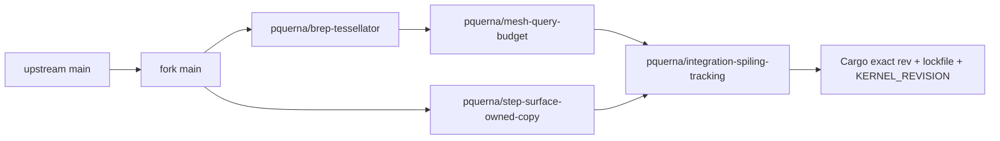

<!--
SPDX-FileCopyrightText: 2026 Spiling contributors
SPDX-License-Identifier: OSL-3.0
Licensed under the Open Software License version 3.0
-->

# Development and packaging

## Prerequisites

- Node24.x, pnpm10.32.1, and the Rust toolchain/components in `rust-toolchain.toml`.
- Native C/C++ tools: MSVC on Windows, Xcode command-line tools on macOS, GTK4/CEF dependencies on Linux.
- Matching pinned CEF distribution in `.cache/cef` or an explicit `CEF_PATH`. Cargo/pnpm lockfiles and shell manifests own versions; do not substitute a system webview or arbitrary CEF archive.

Typical Ubuntu native dependencies:

```sh
sudo apt-get install build-essential pkg-config cmake ninja-build libgtk-4-dev \
  libx11-dev libxrandr-dev libxcomposite-dev libxdamage-dev libnss3-dev \
  libasound2-dev libgbm-dev libsecret-1-dev libssl-dev patchelf desktop-file-utils
pnpm bootstrap
pnpm dev
```

macOS development must use the Tauri CLI so CEF's application bundle/helpers
launch correctly; a bare Rust executable is not equivalent.

[`tools/run.mjs`](../../tools/run.mjs) owns root commands:

| Command            | Purpose                                                              |
| ------------------ | -------------------------------------------------------------------- |
| `pnpm bootstrap`   | Locked install, generation and integrated native/frontend build      |
| `pnpm dev`         | Native CEF development workbench                                     |
| `pnpm build`       | Generate contracts → build/stage engine and CLI → frontend → desktop |
| `pnpm contracts`   | Rust-owned TypeScript generation; `--check` rejects drift            |
| `pnpm check`       | Formatting, Clippy, TypeScript and generated-contract checks         |
| `pnpm test`        | Workspace behavior and real CLI/binary interoperability              |
| `pnpm smoke:cli`   | Actual child startup, operations, transfer and reap                  |
| `pnpm bench:smoke` | Diagnostic process/transfer benchmark, not geometry performance      |
| `pnpm package`     | Current-platform package with sidecar, CEF and notices               |

**Build before running real surfaces.** Direct desktop Cargo builds can overwrite
a fresh engine with a stale staged sidecar. Do not build while a desktop smoke
is live. Reuse one disk-backed Cargo target/profile; development/test profiles
already disable debug information and incremental compilation. Selected numerical
crates are optimized independently of the desktop stack.

## Material authority and qualification

[ADR005](../adr/ADR005-native-first-development-geometry.md) adopts native-first
DEVELOPMENT geometry: one imported SolidCore BREP, exact kernel/tolerance binding,
original STEP identity/provenance and original finish inputs. Implementation and
operator qualification are pending; source5/planner24 remains production. Keep
current operating limits and operators until a coherent cutover; do not publish a
partial native owner or relabel current runtime reports/evidence.

The eventual native route retains independent actual-program/process replay,
not independent original-STEP topology/embedding certification or physical
readiness. Query-private mutation and derived trims cannot silently redefine the
authoritative BREP. Unsupported/indeterminate operations refuse; display meshes
and custom original-source reconstruction are not alternative material paths.
Work, live-byte admission and cancellation remain bounded. Exact pins and builds
are provenance/prerequisites, not complete operator acceptance.

## SolidCore fork freshness

The integration owner refreshes upstream at the start of each active UTC workday
and before a new fork change or consumer pin. `origin` is
`tangency-labs/solidcore`; `fork` is `pquerna/solidcore`. Fork `main` is an upstream
mirror, not the Spiling product branch.



Each logical change has one long-lived `pquerna/*` branch and draft PR **in our
fork**. The budget PR is based on the mesher branch; the other two PRs are based
on fork `main`. Keep scope, rationale, SMLib relationship, evidence and removal
criteria in the [patch registry](solidcore-upstream-review.md). Branch publication
is not PR creation. Never create a PR against `tangency-labs/solidcore` or file an
upstream issue without explicit approval.

### Daily synchronization and promotion

```sh
git fetch origin
git fetch fork
git merge-base --is-ancestor fork/main origin/main
git push fork origin/main:refs/heads/main
```

Divergence requires inspection, not reset or force. In clean owning worktrees,
merge current upstream into the independent mesher and STEP-copy lanes; merge
the updated mesher lane into the budget lane. Then merge the current budget and
STEP-copy lanes into `pquerna/integration-spiling-tracking`. Follow SolidCore's
commit-attribution rules for new synchronization commits.

Published PR branches and the integration branch advance by normal merges.
Rebase only new, unpublished work when first preparing or reorganizing a change;
never rewrite a branch or commit already used by a consumer. This follows the
kernel's published-branch policy while keeping review URLs stable and old exact
pins reachable. Do not merge Spiling overlays into the fork's upstream mirror.

Run the owning resource/backend controls and actual native consumer on the
combined integration tree. Prefer producer-specific Cargo targets when comparing
checked-out baselines. Cargo success and the working directory do not prove
producer identity: a shared target can retain another worktree's workspace Rust
artifacts. If retaining a warm native cache across trees, invalidate all workspace
Rust packages before building the next tree; preserve external/native dependency
artifacts. Before interpreting a comparison or starting a long operator, run
`spiling-cli diagnose` with the exact engine and check its actual Hello build and
native revision against the checked-out contracts and pins. A mismatch invalidates
the comparison, not the source under investigation. Freeze the matching binary
pair for the run and retain its identity with ignored evidence. Record exact
producer, commands and outcomes in evidence or commit/PR notes, not append-only
Markdown logs.

Push updated lanes and integration with normal pushes. Integration is the only
source for new Spiling pins, but its moving tip is not itself a reproducible
dependency: use an exact published `rev`. Promote a consumer pin only after its
relevant real engine/CLI controls, updating both SolidCore package revisions,
`Cargo.lock` and `geometry::KERNEL_REVISION` together. Keep operation refusals and
unqualified journeys explicit; unit checks and branch freshness do not establish
full geometry/manufacturing parity.

### Upstreaming and retirement

Every fork PR states the real consumer requirement, why the change belongs in
the library rather than host-only policy, whether it is an SMLib parity repair
or an extension, dependencies, exercised evidence, known limits, intended
upstream contract and the condition for removing the lane. Preserve inherited
authors and licences. Seek explicit approval before moving a fork proposal
upstream; do not present local Spiling proof failures as kernel bugs.

When upstream supplies a lane's contract, remove the redundant overlay from the
current integration tree, rebase only unpublished preparatory work if necessary,
and qualify the smaller combined tree. Retarget dependent fork PRs when their
base lands upstream. Do not keep compatibility shims or reapply already upstreamed
changes. Preserve old published pins and review history.

This cadence is an integration-owner duty, not an installed unattended timer.
Fork maintenance does not re-enable Spiling's disabled remote CI.

## Resources and test inputs

Root tools default to one Cargo job; raise `CARGO_BUILD_JOBS` explicitly for the
host. Parallel compiler count is not a memory limit. Use a whole-process cgroup
when bounds matter, and distinguish host RAM/disk allowances from geometry
work/depth/tolerance, protocol and watchdog limits. `/tmp` may be RAM-backed.

```sh
export CARGO_TARGET_DIR="$PWD/target" CARGO_INCREMENTAL=0 CARGO_BUILD_JOBS=16
export RAYON_NUM_THREADS=1 RUST_TEST_THREADS=1
systemd-run --wait --pipe --collect --property=WorkingDirectory="$PWD" \
  --property=MemoryMax=16G --property=MemorySwapMax=2G --property=TasksMax=1024 \
  /usr/bin/env PATH="$PATH" CARGO_TARGET_DIR="$CARGO_TARGET_DIR" \
  CARGO_INCREMENTAL=0 CARGO_BUILD_JOBS="$CARGO_BUILD_JOBS" RAYON_NUM_THREADS=1 \
  cargo test --locked -p spiling-manufacturing --lib -- --test-threads=1
```

Choose limits that leave host headroom; system scope/user permissions vary.
Actual-child tests use the freshly built `SPILING_TEST_ENGINE` and explicitly
include ignored integration cases. Rayon1 prevents each child creating its own
large worker pool. Under tight Node task limits, `UV_THREADPOOL_SIZE=1` and
`NODE_OPTIONS=--v8-pool-size=1` are available; trusted intent authoring also accepts
an explicit `GOMAXPROCS` override.

Native tests consume committed immutable original STEP sources; no legacy kernel
checkout or corpus writer is required:

```sh
node tools/verify-fixtures.mjs
cargo run --locked -p spiling-geometry --example inspect_corpus -- fixtures/geometry/box-mm.step
```

The verifier checks manifest hashes, recorded byte counts and OSL sidecars,
not current import or manufacturing support. Manifests retain historical producer
identity; inspection exercises the current facade and reports actual outcomes.
Changed source requires a new name/version. Missing inputs are not expected refusals.

## Native CLI workflows

```sh
CLI="$PWD/target/debug/spiling-cli"
ENGINE="$PWD/target/debug/spiling-engine"
"$CLI" geometry --scene fixtures/geometry/scenes/realistic-native.scene.json \
  --section 0,0,4:0,0,1 --engine "$ENGINE"
"$CLI" project create NEW_PROJECT --import fixtures/geometry/box-mm.step --save --engine "$ENGINE"
"$CLI" project inspect NEW_PROJECT --engine "$ENGINE"
```

Geometry scenes are import/placement recipes, not saved projects. Native face IDs
come from returned source tables, not guessed STEP ordinals. Project flags execute
left-to-right. Save stores captured source bytes, not dependencies on original
paths. Read-only inspection forbids mutation but permits native queries and fresh
bundle verification. Recovery explicitly selects a previous committed checkpoint;
never blindly retry `save_uncertain`.

For manufacturing, author trusted TypeScript only outside the engine, or use the
checked-in inert JSON. Desktop/engine load bounded JSON; they do not execute profiles:

```sh
"$CLI" project create NEW_PRINT_PROJECT --import fixtures/geometry/box-mm.step \
  --intent fixtures/manufacturing/solid-fill.intent.json --center-on-bed 1 --preflight --compile --verify \
  --manufacturing-out NEW_EXPORT --replay-out NEW_MOTION.splr --save --engine "$ENGINE"
"$CLI" project inspect NEW_PRINT_PROJECT --preflight --verify \
  --manufacturing-out NEW_REOPENED_EXPORT --replay-out NEW_REOPENED_MOTION.splr --engine "$ENGINE"
```

The checked software controls use the inert solid-fill intent above. For the
source-backed bore, substitute `fixtures/geometry/through-hole.step` and new
project/export/replay destinations. Its complete Compile and fresh saved-byte
replay do not qualify rounded-housing spherical quotient cuts, general STEP or
physical printing. Keep native refusals explicit rather than switching geometry.

All output destinations must be new. Bed preparation precedes explicit pose Apply;
Preflight is not manufacturing authority. Inspect/replay independently decode saved
program bytes, never trust a stored `verified` flag. Export uses the common exclusive
writer. [Manufacturing](manufacturing-evidence.md) maps the implementation and current
refusals; [authoring](authoring-evidence.md) maps transactions and recovery.

`apps/engine/src/geometry/bed_pose.rs` prepares one immutable native source for
the three directional material-support queries. Its retained domain/vertex-plan
capacity is charged once; each query borrows it and uses only the remaining
shared geometry bytes. Preparation and all directions share the unchanged
20M cumulative contact-work allowance. Exercise this path with `--center-on-bed 1`
before Compile on the ordinary housing above; the revision/nonpenetration gate is
`cargo test --locked -p spiling-engine --test geometry native_bed_contact_is_nonpenetrating_read_only_and_revision_bound`.

Seam and hatch direction are required recipe data: `seam_policy` is `nearest` or
`preferred_build_direction` with normalized build-XY `xy`; `rectilinear_axis` is
`x`, `y`, `alternating_xy` or `alternating_yx`. The production panel exposes these
alongside the existing Apply/history controls and normalizes an authored nonzero
vector on Apply. Compare fresh emitted motion, not only displayed intent: preferred
perimeter entries use existing build-side vertices, ordinary bed hatch follows the
chosen axis, and bridge/support exceptions retain actual-anchor admission. Save,
remove only an owned original source copy, then inspect in a fresh engine to check
the same policies and bytes survive independently of that path.

Source-face finishes are ordinary revision-bound project edits. Use current native
occurrence/face IDs, choose scope and explicitly Apply; Undo/Redo/Save remain Core
operations. Whole-face ribs and image relief retain narrow certified carrier/pose
eligibility despite generic base geometry. Native face descriptions nest optional
analytic carrier data inside `geometry.analytic`; a display or generic descriptor
cannot substitute for the engine's finish certificate. Image preview shows captured
Gray8 data, not displacement. Compile and fresh replay show manufactured paths. Parameter/wire
contracts live in [manufacturing protocol](../protocol/manufacturing.md),
[rib ADR](../adr/002-cylindrical-grip-ribs.md) and [image ADR](../adr/003-spatial-image-relief.md).

## Actual desktop surface

Use a real graphical session with its display, authorization and session bus.
Normal startup requires offline license assent and WebGPU before spawning the
engine. For a fresh debug build:

```sh
SPILING_ENGINE_PATH="$ENGINE" node tools/smoke-desktop.mjs \
  --executable "$PWD/target/debug/spiling-desktop" --scenario manufacturing \
  --require-hardware-gpu --port 9222
SPILING_ENGINE_PATH="$ENGINE" node tools/smoke-desktop.mjs \
  --executable "$PWD/target/debug/spiling-desktop" --scenario geometry \
  --scene fixtures/geometry/scenes/realistic-native.scene.json --port 9222
```

The manufacturing runner exercises intent/placement/history, Compile, actual-byte
report/motion, cancellation, export, source-independent reopen and child cleanup.
Terminal Compile refusal fails the runner immediately with the native diagnostic;
the observation deadline bounds pending work, not a wait after a known failure.
Geometry clicks target visible viewport interiors from the captured rendered
surface, then require a real native face inspection from physical pointer events.
A missed sparse coordinate grid is not evidence that production picking failed.
`--evidence-directory NEW_DIRECTORY` retains screenshots and failure state;
native section/query refusal remains independent of a successful pick.

`--manufacturing-source RELATIVE_STEP` selects `housing-ordinary.intent.json`
for the rounded-housing and ribbed-bracket references; other sources retain the
runner's explicit complete intent. Refused geometry never becomes success.
The ordinary reference uses the same0.10 mm physical schedule/process with fill
and top skin both AlternatingXY. For the housing zone/plate journey, compile the
uniform0.25 job before authoring whole-owned0.60 and lower source box
`[-1,-1,-1]..[25,19,5.03]` at0.20. The final `--process-set-box` token
`horizontal-diaphragm:0.23` explicitly permits the centered0.23 mm permanent
plate. Source-Z5.03 is not world height; the captured pose determines its actual
slab. `--process-diaphragm` with the named-source hardware smoke uses this ordinary
profile and exercises lower-density edit/history/recompile, source-hidden actual
skin joints/annular plate, slab/material inspection and unrepresentable-thickness
refusal, then pose/history/save/source-delete/fresh read-only replay/export.

`housing-h1-fine.intent.json` and `housing-h1-combined.intent.json` remain separate
fixed-X XY-separator controls; alternating XY separator construction is explicitly
unsupported. Their genuine coarse positive control is not the ordinary default.
The fixed-X whole-width plate control can truthfully retain every band fine under
CombineEligible because its actual parallel gap exceeds the10 mm bridge limit.
Do not compare different axes as an optimization or force coarse deposition.
The ordinary Fine housing/plate makes no coarse-success claim. Any changed axis or
CombineEligible request still has its own native/actual-support obligations.
Plate Compile requires captured full-height strong native inner-material authority;
invariant metadata alone is not admission, and unsupported plate/upper attachment
cannot silently acquire temporary scaffolding.
Geometry exercises shared definitions, native picking/sections and transfer lifetime.
`surface-finish`, `cylindrical-finish`, `image-relief` and `image-relief-planar` exercise
their corresponding authoring/Compile/replay flows. `project-bridge` bypasses GPU
admission to exercise native storage/bridge behavior, not visible/pickable acceptance.

Headless-only diagnostic attachment is explicit, not hardware qualification:

```sh
SPILING_ENGINE_PATH="$ENGINE" SPILING_CEF_UNSANDBOXED=1 xvfb-run -a \
  node tools/smoke-desktop.mjs --executable "$PWD/target/debug/spiling-desktop" \
  --scenario manufacturing --diagnostic-no-gpu --port 9222
```

Never ship diagnostic overrides as defaults. `SPILING_CEF_DEBUG_PORT` enables a
privileged local debugging endpoint; it is normally off. Debug fixture admission
uses confined native tokens, not renderer filesystem access. [Runtime boundaries](B0-evidence.md)
cover CEF loader, trusted desktop isolation and GPU fallback. Linux native dialogs
require a working xdg-desktop-portal backend; bridge tests do not exercise dialogs.

## Packaging, CI and recording results

`pnpm package` selects Debian, macOS `.app` or Windows NSIS. It builds release once,
collects native notices, then bundles existing binaries under `target/release/bundle/`.
Installed CEF Debian layout resolves the sidecar from the installation-prefix `bin`;
other packages resolve it adjacent to the actual executable. A debug engine override
is not an installed-path fallback.

Automatic remote CI is disabled for pushes and pull requests. Native platform
packaging remains available only through explicit workflow dispatch. Run affected
checks and real-surface smoke locally; full checks are `pnpm check` and `pnpm test`.
Neither compilation nor a local smoke establishes installed-platform or physical-machine
qualification. Report actual failures, not a pass inferred from selected filters.

Commit/PR verification notes contain changed behavior, exercised commands, outcomes
and remaining risks. Detailed logs, screenshots, identities and measurements belong
in CI or ignored `artifacts/`. Keep this runbook and code maps current; do not append
checkpoint histories. [SOURCE](SOURCE.md) and [license](../license.md) govern source,
notices, assent and release obligations.
