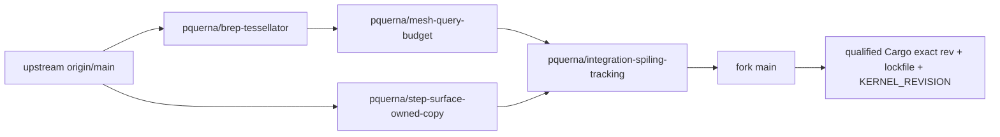

<!--
SPDX-FileCopyrightText: 2026 Spiling contributors
SPDX-License-Identifier: OSL-3.0
Licensed under the Open Software License version 3.0
-->

# Development and packaging

## Prerequisites

- Node24.x, pnpm10.32.1, and the Rust toolchain/components in `rust-toolchain.toml`.
- Native C/C++ tools: MSVC on Windows, Xcode command-line tools on macOS, GCC/Clang and pkg-config on Linux.
- Vulkan/Metal/DX12 graphics, an OS window session and native dialog services.

Typical Ubuntu native dependencies:

```sh
sudo apt-get install build-essential pkg-config cmake ninja-build libssl-dev \
  libx11-dev libxkbcommon-dev libwayland-dev libvulkan1 \
  xdg-desktop-portal xdg-desktop-portal-gtk desktop-file-utils
pnpm bootstrap
pnpm dev
```

Linux needs a working XDG desktop portal/file chooser backend. The workbench uses
X11 or Wayland directly and wgpu; no browser runtime, web server or GTK widget
build is required. A suitable Vulkan driver must be installed separately.

[`tools/run.mjs`](../../tools/run.mjs) owns root commands:

| Command                           | Purpose                                                                                  |
| --------------------------------- | ---------------------------------------------------------------------------------------- |
| `pnpm bootstrap`                  | Locked install/fetch, contract drift check and matching native build                     |
| `pnpm dev`, `pnpm dev:native`     | Build and launch the native workbench                                                    |
| `pnpm build`, `pnpm build:native` | Build engine, workbench and CLI together                                                 |
| `pnpm gallery:native`             | Production controls/themes without an engine                                             |
| `pnpm test:native`                | Host checks and sequential actual-child operator regressions                             |
| `pnpm contracts --check`          | Reject Rust-derived TypeScript and packed-golden drift                                   |
| `pnpm check`                      | Formatting, Clippy, TypeScript and contract checks                                       |
| `pnpm test`                       | Workspace behavior, real CLI and packed interoperability                                 |
| `pnpm smoke:cli`                  | Actual child startup, operations, transfer and reap                                      |
| `pnpm bench:smoke`                | Diagnostic process/transfer benchmark, not geometry performance                          |
| `pnpm compare:slicers`            | Independent commanded G-code comparison; see [contract](gcode-parity.md)                 |
| `pnpm test:parity`                | Independent observer fault/accounting tests                                              |
| `pnpm package`                    | Clean-source release binaries, source/notices, portable archive and Linux Debian package |
| `node tools/run.mjs provenance`   | Collect native dependency and data-tool provenance/notices                               |

Build the matching engine and workbench before real-surface acceptance. Do not
replace binaries while their window/engine is live. Reuse one disk-backed target
and honor `CARGO_TARGET_DIR`; development/test profiles disable debug information
and incremental compilation. Selected numerical crates are optimized separately.

## Native egui workbench

[ADR006](../adr/006-native-egui-workbench.md) selects the permanent
`apps/workbench` application. The current increment manages projects through the
existing supervised engine and displays admitted native sources, shared occurrences,
source-face inspection/picking and sections. Prepare loads a complete inert intent,
commits full policy and whole/boxed source-sparse edits, reviews native bed placement and
runs engine Preflight/Compile. Review performs fresh independent verification,
retrieves checked actual SPLR6 motion and exclusively exports four files. `pnpm dev`
is native. Finish authors scoped planar/cylindrical ribs, Smooth overrides and
canonical PNG/PGM relief, layer enable/remove and stored-image reuse. Review retains
H1 decisions, physical plate/region accounting, native coverage, surface exposure/
optical reassessment and declared tool tints. Study loads retained complete optical
reports and explicitly binds accepted selections to existing loaded declarations
and source constructions. Palette/study authoring remains available through CLI.

Prepare selects bounded inert material/setup profile JSON through a parented native
picker. Loading is transient; **Apply material profile** uses the existing engine
transaction. Explicit temperature, speed, flow and whole-process overrides retain
their provenance separately from profile values. Selected setup and source remain inspectable; **Applied engine values** shows
the committed process values and effective machine/material flow ceiling. Conflicting
or stale edits retain their drafts; **Reload captured profile** explicitly discards
them. Material-bound recipe fields are edited through these overrides. Complete
single-tool Marlin intent is required; synthetic declarations and imported
recommendations are not calibration.
Review switches between actual centerlines and nominal bead surfaces, with layer,
event, role and tool filters. Visible width/height ranges follow the current
selection; cached statistics bind the immutable display identity. A layer schedule
interval is distinct from a combined stroke's physical interval. Beads retain
decoded straight endpoints and each nominal width/physical Z interval. Sections are stadium envelopes; bridges use
elliptical envelopes, with explicit flat ends and visible overlapping strokes.
This display neither predicts physical bead shape/sag nor computes deposited mass.
Numerical expansion and cross-section chord errors each stay within 0.001 mm.
The view admits at most 100,000 strokes and 40 million vertex invocations inside
the existing combined CPU/GPU budget; otherwise it explains the limit and retains
checked centerlines. Camera orientation and fresh review preserve existing framing;
Fit and Fit source remain explicit actions. Review does not regenerate geometry
when scrubbing or filtering.

For actual-window acceptance, inspect an admitted wall/bridge and genuine H1
physical intervals, switch layer/role/tool and centerline/bead views, and change a
consumed width/process value. Observe old review invalidation, fresh output,
history, save/close/source-independent reopen and fresh verified exclusive export.
Compare native/CLI output under the same captured input and observe child cleanup.
Large-input/projection refusals must preserve usable centerlines.

The legacy browser frontend and its build/runtime paths have been removed.

```sh
pnpm build:native     # locked matching engine, CLI and window
pnpm dev              # build, then run the native window (dev:native is identical)
pnpm gallery:native   # production theme/components, illustrative data, no engine
pnpm test:native      # matching binaries, host checks, sequential actual-child checks
```

The native route needs Rust/native build tools, Vulkan/Metal/DX12 graphics and
OS window/dialog services. On Linux, X11 or Wayland and a working XDG desktop
portal/file chooser are required. These commands honor `CARGO_TARGET_DIR` and resource overrides.
Use a separate target when concurrent engine work would replace workspace
artifacts; do not build into another live smoke's target. The installed lookup
expects `spiling-engine` beside `spiling-workbench`. Debug builds alone allow an
absolute `SPILING_ENGINE_PATH` override. Startup validates the existing exact
engine identity, kernel and capability contract; no mixed-build negotiation exists.

The native binary also accepts `--read-only --open PROJECT_DIRECTORY`; paths
preserve native encoding and use the same guarded Open as the picker. License
assent still precedes engine/project admission. One process supervises one project;
Core's writer lock remains authoritative.

First save chooses a **new project directory name** through the native Save
dialog; Core creates it. Open/read-only/recovery choose an existing project
directory. Ordinary Save checkpoints the attached route. A failed Save As does not
attach its destination. A receipt-owned uncertain save can attach a route and is
shown explicitly; a prior uncertainty flag cannot attach a later failed action.
Restart reopens only a route attached by an observed Open/Save receipt. Undo/Redo
and dirty replacement retain engine authority. Preferences store only local
license assent, theme and eframe window state.

For actual-window acceptance, use a coherent current saved project created by this
engine. Launch in the real graphical session, accept the offline license, select
the project through the parented native picker and inspect its path, revisions,
native definition/occurrence counts and expanded build/session/PID. Import an owned
admitted STEP copy to make it dirty, cancel New/Open/close discard and verify the
same project/revision remains. Save to a new directory, then checkpoint that route.
Reopen read-only, inspect state, close and observe that the child PID has exited.
Exercise picker cancellation, engine death/restart and startup mismatch separately;
accepted operations must have bounded visible progress/errors and explicit
observation/cancellation semantics. Host checks do not substitute for dialogs,
actual window/GPU or platform packaging acceptance. Preserve run output and
producer/environment identities in ignored artifacts or PR verification notes.

Native source inspection uses `scene` for revision-bound pages, complete face tables and
checked SPLM/SPLS transfers, and `viewport` for shared raw GPU storage, f64-rebased
placement, camera and native face picking. Import an admitted part, click a source
face and compare the exact engine inspection with the tree selection. Add a copy
at an explicit edited pose, fit the source, and request a native section at a declared
Z. Metadata-only project edits do not reload meshes. Pause/resume retains the prior
labelled source; stale revisions cannot pick or mutate. Geometry-only definitions
retain native face-list inspection without invented display. A source projection
exceeding the additional 0.001 mm display budget refuses publication and retains
the previous scene; native queries remain authoritative. This is not exact display
measurement or general STEP qualification.

For the manufacturing journey, import an unchanged admitted housing from an owned
copy and load a full intent JSON through its native file picker. Apply a consumed
sparse value, select the occurrence, prepare and review native placement, explicitly
Apply, then Preflight and Compile. Review requires **Fresh Verify and load motion**;
stored verification alone cannot enable Export. Exercise source-hidden replay,
true layer intervals, event/travel controls and the independent report's coverage
and limitations. Export selects a **new directory name**, writing plan.json,
program.gcode, verification.json and provenance.json without overwriting. Reusing
a destination must fail and preserve it. Undo/Redo invalidates captured review;
save, close/reap, delete only the owned external STEP copy, reopen read-only in a
fresh engine, then freshly Verify/replay/export again. Compare program bytes and
captured identities. This is software workflow evidence, never machine readiness.

For native material acceptance, load a matching explicit single-tool intent, select
a profile/setup JSON through **Load material profile…**, and inspect its source
and hardware declarations before Apply. Enable a temperature/speed override,
apply and inspect **Applied engine values**; Undo/Redo must restore the complete
capture. Attempt an incompatible profile and a stale draft: neither may replace
the committed intent. Save, close/reap, remove only the owned external profile,
reopen and inspect the captured values, then Preflight/Compile/freshly Verify and
exclusively export. Compare emitted bytes and captured values with the CLI on
that saved project. Clearing an override restores inheritance only after Apply.

The host separates request acknowledgements from background display publications.
Review/export workers retain captured identities and recheck the active record;
close waits for staged output cleanup and child exit. Input revision is immutable
artifact provenance and can precede compilation's project publication revision.
A current capture binds the observed project revision separately. Display memory
accounts active/staged source, section and motion together; prior replay GPU charge
is conservatively retained until the engine session ends.

The `inspection` Cargo feature enables upstream development inspection tooling;
it is off by default and must stay off in distributions. It is not a second
mutation API or qualification of native dialogs. Upstream default fonts do not cover all CJK labels. Additional font/input/assistive combinations remain separately unqualified.

## Material authority and qualification

[ADR005](../adr/ADR005-native-first-development-geometry.md) adopts the implemented
source11/planner39 DEVELOPMENT route: one imported SolidCore BREP, exact
kernel/tolerance binding, original STEP identity/provenance and original finish
inputs. Qualify preserved operators with the actual coherent producer; do not
relabel source5/planner24 reports or transfer older runtime evidence.

The native route retains independent actual-program/process replay,
not independent original-STEP topology/embedding certification or physical
readiness. Query-private mutation and derived trims cannot silently redefine the
authoritative BREP. Unsupported/indeterminate operations refuse; display meshes
and custom original-source reconstruction are not alternative material paths.
Work, live-byte admission and cancellation remain bounded. Exact pins and builds
are provenance/prerequisites, not complete operator acceptance.

SolidCore and solidcore-mesh retain exact published fork pins. Only the
SolidCraft geometry/STEP companion libraries are vendored: relative Cargo paths
under `vendor/solidcraft/` include the exact homogeneous-boundary closure patch,
upstream licenses and bounded conformance inputs. `UPSTREAM.toml` records their
source and modifications. No SolidCraft application fork or machine-local Cargo
override is needed. Update this snapshot as a coherent two-crate unit and rerun
its semantic regressions plus affected import/manufacturing operators.

Run the excluded libraries' tests with
`cargo test --offline --manifest-path vendor/solidcraft/crates/geom/Cargo.toml`
and the corresponding `step/Cargo.toml` path, not workspace `-p` selection.
The retained placed-revolution failure is documented in
[geometry limits](geometry-evidence.md#refusals-and-support-boundary); do not
hide it by skipping the test or weaken its PCurve assertion.

## SolidCore fork freshness

The integration owner refreshes upstream at the start of each active UTC workday
and before a new fork change or consumer pin. `origin` is
`tangency-labs/solidcore`; `fork` is `pquerna/solidcore`. Upstream `origin/main`
is the baseline; fork `main` publishes the tested Spiling integration, including
its maintained overlays.



Each logical change has one long-lived `pquerna/*` branch in our fork. The budget
lane builds on the mesher; the independent mesher and STEP-copy lanes merge
upstream `origin/main`, not the composed fork `main`. Publish the tested
integration directly to fork `main`; GitHub issues, PRs and API authentication
are not prerequisites. Keep scope, rationale, SMLib relationship, evidence and
removal criteria in the [patch registry](solidcore-upstream-review.md). Never
create an upstream issue or PR without explicit approval.

### Daily synchronization and promotion

```sh
git fetch origin
git fetch fork
```

Divergence requires inspection, not reset or force. In clean owning worktrees,
merge current upstream into the independent mesher and STEP-copy lanes; merge
the updated mesher lane into the budget lane. Then merge the current budget and
STEP-copy lanes into `pquerna/integration-spiling-tracking`. Follow SolidCore's
commit-attribution rules for new synchronization commits.

Published patch branches and the integration branch advance by normal merges.
Rebase only new, unpublished work when first preparing or reorganizing a change;
never rewrite a branch or commit already used by a consumer. This follows the
kernel's published-branch policy while keeping branch URLs stable and old exact
pins reachable. Do not replace the composed fork `main` with an upstream mirror.

Run the owning resource/backend controls and actual native consumer on the
combined integration tree. Prefer producer-specific Cargo targets when comparing
checked-out baselines. Cargo success and the working directory do not prove
producer identity: a shared target can retain another worktree's workspace Rust
artifacts. If retaining a warm native cache across trees, invalidate all workspace
Rust packages before building the next tree; preserve external/native dependency
artifacts. Before interpreting a comparison or starting a long operator, run
`spiling-cli diagnose` with the exact engine and check its actual Hello build and
native revision against the checked-out contracts and pins. A mismatch invalidates
the comparison, not the source under investigation. Freeze the matching binary
pair for the run and retain its identity with ignored evidence. Record exact
producer, commands and outcomes in evidence or commit/PR notes, not append-only
Markdown logs.

Push updated lanes and integration with normal pushes, then publish that same
tested integration directly to fork `main`:

```sh
git merge-base --is-ancestor fork/main pquerna/integration-spiling-tracking
git push fork pquerna/integration-spiling-tracking:refs/heads/main
```

Use the local integration branch that owns the tested tree. If fork `main` has
advanced independently, incorporate it into integration and requalify the result;
never force-push or discard another publisher's work. New Spiling pins come from
this tested, published main/integration history, not an unqualified moving tip:
use an exact published `rev`. Promote a consumer pin only after its
relevant real engine/CLI controls, updating both SolidCore package revisions,
`Cargo.lock` and `geometry::KERNEL_REVISION` together. Keep operation refusals and
unqualified journeys explicit; unit checks and branch freshness do not establish
full geometry/manufacturing parity.

### Upstreaming and retirement

The patch registry and publication commit notes state the real consumer
requirement, why the change belongs in the library rather than host-only policy,
whether it is an SMLib parity repair
or an extension, dependencies, exercised evidence, known limits, intended
upstream contract and the condition for removing the lane. Preserve inherited
authors and licences. Seek explicit approval before moving a fork proposal
upstream; do not present local Spiling proof failures as kernel bugs.

When upstream supplies a lane's contract, remove the redundant overlay from the
current integration tree, rebase only unpublished preparatory work if necessary,
and qualify the smaller combined tree. Adjust dependent lanes when their base
lands upstream. Do not keep compatibility shims or reapply already upstreamed
changes. Preserve old published pins and branch history.

This cadence is an integration-owner duty, not an installed unattended timer.
Fork maintenance does not re-enable Spiling's disabled remote CI.

## Resources and test inputs

Root tools default to one Cargo job; raise `CARGO_BUILD_JOBS` explicitly for the
host. Root Rust test commands default `RUST_MIN_STACK` to 8 MiB for debug typed
RPC futures, matching the native host runtime; explicit overrides are preserved.
Direct Cargo integration-test runs need the same setting. This test-harness
stack does not change native geometry work, depth, byte or tolerance policies.
Parallel compiler count is not a memory limit. Use a whole-process cgroup
when bounds matter, and distinguish host RAM/disk allowances from geometry
work/depth/tolerance, protocol and watchdog limits. `/tmp` may be RAM-backed.

```sh
export CARGO_TARGET_DIR="$PWD/target" CARGO_INCREMENTAL=0 CARGO_BUILD_JOBS=16
export RAYON_NUM_THREADS=1 RUST_TEST_THREADS=1 RUST_MIN_STACK=8388608
systemd-run --wait --pipe --collect --property=WorkingDirectory="$PWD" \
  --property=MemoryMax=16G --property=MemorySwapMax=2G --property=TasksMax=1024 \
  /usr/bin/env PATH="$PATH" CARGO_TARGET_DIR="$CARGO_TARGET_DIR" \
  CARGO_INCREMENTAL=0 CARGO_BUILD_JOBS="$CARGO_BUILD_JOBS" RAYON_NUM_THREADS=1 \
  cargo test --locked -p spiling-manufacturing --lib -- --test-threads=1
```

Choose limits that leave host headroom; system scope/user permissions vary.
Actual-child tests use the freshly built `SPILING_TEST_ENGINE` and explicitly
include ignored integration cases. Rayon1 prevents each child creating its own
large worker pool. Under tight Node task limits, `UV_THREADPOOL_SIZE=1` and
`NODE_OPTIONS=--v8-pool-size=1` are available; trusted intent authoring also accepts
an explicit `GOMAXPROCS` override.

Native tests consume committed immutable original STEP sources; no legacy kernel
checkout or corpus writer is required:

```sh
node tools/verify-fixtures.mjs
cargo run --locked -p spiling-geometry --example inspect_corpus -- fixtures/geometry/box-mm.step
```

The verifier checks manifest hashes, recorded byte counts and OSL sidecars,
not current import or manufacturing support. Manifests retain historical producer
identity; inspection exercises the current facade and reports actual outcomes.
Changed source requires a new name/version. Missing inputs are not expected refusals.

## Native CLI workflows

```sh
CLI="$PWD/target/debug/spiling-cli"
ENGINE="$PWD/target/debug/spiling-engine"
"$CLI" geometry --scene fixtures/geometry/scenes/realistic-native.scene.json \
  --section 0,0,4:0,0,1 --engine "$ENGINE"
"$CLI" project create NEW_PROJECT --import fixtures/geometry/box-mm.step --save --engine "$ENGINE"
"$CLI" project inspect NEW_PROJECT --engine "$ENGINE"
```

Geometry scenes are import/placement recipes, not saved projects. Native face IDs
come from returned source tables, not guessed STEP ordinals. Project flags execute
left-to-right. Save stores captured source bytes, not dependencies on original
paths. Read-only inspection forbids mutation but permits native queries and fresh
bundle verification. Recovery explicitly selects a previous committed checkpoint;
never blindly retry `save_uncertain`.

Geometry-free palette and optical studies use the same engine/CLI. [Project appearance contracts](../protocol/project.md#optical-reference-construction-studies) own the strict JSON example and source-absent reopen procedure. Build engine/CLI, then run the selected real-child gates without starting the native window or compiling geometry:

```sh
SPILING_TEST_ENGINE="$ENGINE" cargo test --locked -p spiling-cli --test project optical_study_source_deleted_reopen_and_revision_owned_acceptance -- --ignored --exact --test-threads=1
cargo test --locked -p spiling-engine --test project optical_cancelled_report_is_transient_and_stale_comparisons_cannot_publish -- --exact --test-threads=1
cargo test --locked -p spiling-appearance --test optical
```

The named Prusa v7 model is a numerical reference estimate, not measured Spiling color or mixed-printing support. The example exercises finite physical exposure and bounded search; no GUI, backing-transport model, printer route or physical qualification follows.

For manufacturing, author trusted TypeScript only outside the engine, or use the
checked-in inert JSON. Desktop/engine load bounded JSON; they do not execute profiles:

```sh
"$CLI" project create NEW_PRINT_PROJECT --import fixtures/geometry/box-mm.step \
  --intent fixtures/manufacturing/solid-fill.intent.json --center-on-bed 1 --preflight --compile --verify \
  --manufacturing-out NEW_EXPORT --replay-out NEW_MOTION.splr --save --engine "$ENGINE"
"$CLI" project inspect NEW_PRINT_PROJECT --preflight --verify \
  --manufacturing-out NEW_REOPENED_EXPORT --replay-out NEW_REOPENED_MOTION.splr --engine "$ENGINE"
```

The checked software controls use the inert solid-fill intent above. For the
source-backed bore, substitute `fixtures/geometry/through-hole.step` and new
project/export/replay destinations. Its complete Compile and fresh saved-byte
replay do not qualify rounded-housing spherical quotient cuts, general STEP or
physical printing. Keep native refusals explicit rather than switching geometry.

All output destinations must be new. Bed preparation precedes explicit pose Apply;
Preflight is not manufacturing authority. Inspect/replay independently decode saved
program bytes, never trust a stored `verified` flag. Export uses the common exclusive
writer. [Manufacturing](manufacturing-evidence.md) maps the implementation and current
refusals; [authoring](authoring-evidence.md) maps transactions and recovery.

### Fixed-dual software job

Use two upright occurrences of the same committed box, not a global layer-color
instruction. The first receipt supplies the immutable definition ID for `--add`:

```sh
"$CLI" project create NEW_DUAL_PROJECT --import fixtures/geometry/box-mm.step \
  --pose 1 '{"translation_mm":[20,20,0],"rotation_xyzw":[0,0,0,1]}' --engine "$ENGINE"
"$CLI" project edit NEW_DUAL_PROJECT \
  --add DEFINITION_ID_FROM_CREATE '{"translation_mm":[120,20,0],"rotation_xyzw":[0,0,0,1]}' \
  --intent fixtures/manufacturing/fixed-dual.intent.json --preflight --compile --verify \
  --manufacturing-out NEW_DUAL_EXPORT --save --engine "$ENGINE"
"$CLI" project inspect NEW_DUAL_PROJECT --verify \
  --manufacturing-out NEW_DUAL_FRESH_EXPORT --replay-out NEW_DUAL.splr --engine "$ENGINE"
```

The intent explicitly binds occurrences1/2, both immutable material declarations,
fixed hotend offsets, exclusive work reservations and separate supported waste
lanes. Inspect the actual command/report/SPLR6 result for both addressed thermal
states, actual tool epochs, exact E8 recovery and separate per-tool model/waste
accounting. It is a source-reviewed software reference, not deployable Marlin
configuration, measured calibration, calibrated color or a physical print claim.
Native/finish/support/coarse eligibility is not inherited from the single-tool
workflow; [the finite route contract](../protocol/manufacturing.md#fixed-dual-software-route)
owns refusals.

To exercise recovery, import from a disposable copy of the STEP, save, remove only
that external copy, then repeat fresh read-only inspection/export to new names.
Use `project edit --intent CHANGED_INTENT --undo --redo --undo --verify --save` for
source/material route history; the restored input must restore its original
manufacturing identity. `--replay-out` belongs to create/inspect, not edit. The
native full-intent/replay consumer uses the same saved job and decoded bytes;
it does not recolor source meshes or simulate physical filament appearance.

For executable whole-occurrence physical cycles, substitute
`fixtures/manufacturing/fixed-dual-cycle.intent.json` in the same two-box workflow.
It reuses the static route and existing optical `LayerCycle`, with explicit A/B
bindings, equal0.2-mm slots, origin0 and opposite occurrence phases. Inspect actual
tool/XYZ/E plus complete physical intervals: two occurrences at common Z must keep
their independent material, while native finer intervals within one slot keep
the same phase. Counts alone cannot distinguish a real cycle from static coloring.
Swap both phase values in a disposable intent to obtain a different actual program;
undo/redo/undo must restore the original manufacturing input and output. A changed
height/origin must re-resolve or refuse, never silently advance by layer number.

### Source-bound planar surface-color smoke

After building the matching engine and CLI, run:

```sh
node tools/smoke-surface-color.mjs
```

The runner honors `CARGO_TARGET_DIR`, uses fresh owned project/source copies and exclusive export destinations, and retains receipts under ignored `.cache/surface-color-*`. It selects actual returned upright planar face identities on the committed box and through-hole input, then exercises full-face and finite horizontal-window construction, inspectable native source frames, physical skin/backing depth, sparse core, shell physical cycles with native partial intervals, all-white model jobs with a waste-only feeder, actual tool operations, revision/history and source-deleted fresh replay/export. Two independent finite windows additionally exercise opposite same-Z regional phases and positive-volume overlap refusal. The `corner` cases select both returned adjoining faces, union compatible bands once, edit physical depths and refuse intersecting incompatible depths while retaining source holes. The independent TypeScript decoder checks actual regional tool operations and every tool/layer epoch/supported waste stroke. Optional positional mode names (for example `regional`) select a focused subset; no arguments runs every case. Unsupported source identity, thin skin and consumed core must fail. Native material assets in saved projects are retained. The [surface-color contract](../protocol/manufacturing.md#source-bound-planar-surface-color) defines software scope; no physical print, calibrated white/color or desktop authoring claim follows.

The `study` cases retain and reopen an accepted optical selection, refuse an incorrect evidence binding, apply through the typed native operation, and compare the requested 0.15 mm exposure with the actual 8 mm construction. Captured evidence and fresh reassessment survive depth/history/pose edits and deletion of external STEP/palette/study files. Synthetic `fixtures/appearance/surface-color.palette.json` is declared catalog data, not measured filament. `provenance.json.inspection.surface_color` retains the fresh geometry/optical result.

For native GPU inspection, launch `spiling-workbench --read-only --open
CLI_OUTPUT/box-mm-study.spiling` in the real graphical session. Review → Fresh
Verify and load motion retrieves the independent program. Hide Source/Travel,
inspect tool/role and requested/realized exposure, then exclusively export and
close/reap. Study → Load retained reference report exposes retained selection and
explicit declaration bindings. Changing a retained selection requires Recompare
current study in the current engine session before Accept; loading a retained
report alone does not admit a new selection. Already accepted selections can be
applied with explicit current material/construction bindings. Palette/study creation remains CLI; native Study
application is a typed Core transaction, never a local optical model.

`apps/engine/src/geometry/bed_pose.rs` prepares one immutable native source for
the three directional material-support queries. Retained native domains and
correspondence-map capacity are charged once; each query uses only the remaining
shared geometry bytes. Preparation and all directions share the unchanged
20M cumulative contact-work allowance. Exercise this path with `--center-on-bed 1`
before Compile on the ordinary housing above; the revision/nonpenetration gate is
`cargo test --locked -p spiling-engine --test geometry native_bed_contact_is_nonpenetrating_read_only_and_revision_bound`.

Seam and hatch direction are required recipe data: `seam_policy` is `nearest` or
`preferred_build_direction` with normalized build-XY `xy`; `rectilinear_axis` is
`x`, `y`, `alternating_xy` or `alternating_yx`. The production panel exposes these
alongside the existing Apply/history controls and normalizes an authored nonzero
vector on Apply. Compare fresh emitted motion, not only displayed intent: preferred
perimeter entries use existing build-side vertices, ordinary bed hatch follows the
chosen axis, and bridge/support exceptions retain actual-anchor admission. Save,
remove only an owned original source copy, then inspect in a fresh engine to check
the same policies and bytes survive independently of that path.

Source-face finishes are ordinary revision-bound project edits. Use current native
occurrence/face IDs, choose scope and explicitly Apply; Undo/Redo/Save remain Core
operations. Whole-face ribs and image relief retain narrow certified carrier/pose
eligibility despite generic base geometry. Native face descriptions nest optional
analytic carrier data inside `geometry.analytic`; a display or generic descriptor
cannot substitute for the engine's finish certificate. Image preview shows captured
Gray8 data, not displacement. Compile and fresh replay show manufactured paths. Parameter/wire
contracts live in [manufacturing protocol](../protocol/manufacturing.md),
[rib ADR](../adr/002-cylindrical-grip-ribs.md) and [image ADR](../adr/003-spatial-image-relief.md).

## Input and actual-window review

The native procedures above use the production window and parented OS pickers.
`Ctrl/Cmd+K` opens searchable commands; Project/Edit/Manufacturing menus and the
palette share the same typed dispatcher and disabled reasons. Text fields retain
text undo and IME ownership. Tab reaches controls and the canvas; with the canvas
focused, arrows orbit, Shift+arrows pan, plus/minus zoom, F fits, 1 selects Top and
0 Isometric. The model tree's native face list is the keyboard picking alternative.
Narrow windows show either Models or the inspector beside the canvas; the Models
toggle switches panes. UI layout/camera changes never fetch or mutate geometry.

Choose Graphite/Paper in Help. Exercise narrow/wide windows, pane resize, clipboard, keyboard
commands and numeric edits. Cancel native pickers and dirty replacement, then
verify focus and unchanged project identity. Verify save/open/export under owned
Unicode paths and a fresh user preference root. Native X11, Wayland, Windows and
macOS input/assistive stacks require separate evidence. Default fonts do not cover
all CJK glyphs. AccessKit support is enabled, but full IME, mixed-direction text,
screen-reader and mixed-DPI behavior remain unqualified.

## Packaging, CI and recording results

`pnpm package` refuses a dirty worktree, checks contract drift, builds release
engine/workbench/CLI once with default features (inspection off), and collects
notices. `CARGO_TARGET_DIR/release/bundle/` contains a target-named portable
`.tar.gz`; Linux additionally gets a `.deb`. macOS uses a `.app` inside the archive;
Windows gets adjacent `.exe` files. Windows/macOS builds, signing, notarization,
installers, associations and upgrade behavior are not qualified by Linux evidence.

Portable Linux/Windows binaries are adjacent; macOS binaries share `Contents/MacOS`.
The engine is resolved relative to the actual workbench executable, never cwd/PATH.
Linux Debian installs the same layout in `/opt/spiling`, with a `spiling` launcher
and desktop entry. The package does not modify user projects/preferences on removal.
Do not infer ABI portability from a successful build: the Debian dependency floor
and supported host/driver must be checked against the actual build environment.

Every layout carries original icon/font/dependency notices, provenance, the full
OSL license and an exact tracked-source archive. Native offline license assent
precedes engine startup. Source archives contain the committed public tree only;
private/untracked data are excluded. Publish the recorded commit before distributing.

For package acceptance, extract into an owned directory, use fresh XDG app-data/
config roots (or the platform equivalent), launch the packaged executable from
another cwd without an engine override, accept the license, open a saved project,
freshly verify/load replay and export. Close and observe the adjacent child exit.
Inspect archive and Debian contents/permissions/dependencies, install/launch/remove
on a disposable supported host before claiming system-install or upgrade coverage.

Automatic remote CI is disabled for pushes and pull requests. Native platform
packaging remains available only through explicit workflow dispatch. Run affected
checks and real-surface smoke locally; full checks are `pnpm check` and `pnpm test`.
Neither compilation nor a local smoke establishes installed-platform or physical-machine
qualification. Report actual failures, not a pass inferred from selected filters.

Commit/PR verification notes contain changed behavior, exercised commands, outcomes
and remaining risks. Detailed logs, screenshots, identities and measurements belong
in CI or ignored `artifacts/`. Keep this runbook and code maps current; do not append
checkpoint histories. [SOURCE](SOURCE.md) and [license](../license.md) govern source,
notices, assent and release obligations.

## Material-profile engine smoke

`pnpm test:materials` builds the matching engine and CLI, applies paired explicit
synthetic material/setup profiles to an admitted native cube, inspects actual
thermal/fan/feed/extrusion commands, exercises Core Undo/Redo and rejected profile
edits, then removes external authoring inputs before fresh-process verification
and byte-identical export. Evidence is retained in ignored
`.cache/material-profiles-*` directories. The runner records executable identities,
inputs and outcomes; its independent decoder is shared with the
[G-code comparison](gcode-parity.md), not the production verifier. Synthetic profile
values and nominal output accounting do not establish physical material behavior.
